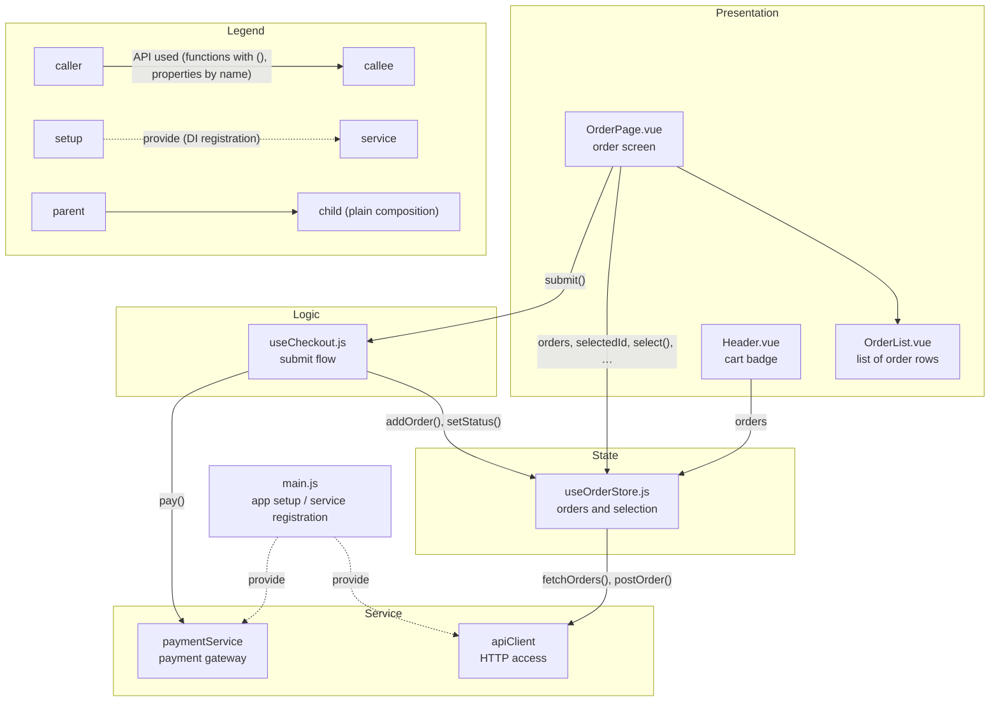

Create a module-structure diagram as Markdown with a Mermaid `graph TD`.

## Steps

1. Grep the feature's entry points and list the modules involved (exclude `__tests__`).
2. Group the modules into layers with one `subgraph` each. Name the layers after the
   project's own architecture (check the directory layout and conventions), using these
   roles as a guide:
   - Presentation: renders UI and handles user input
   - Logic: reusable behavior without its own state (hooks, composables, helpers)
   - State: holds shared application state
   - Service / Infrastructure: talks to outside systems or the platform
   - Data / Domain: models and core entities

   Use only the layers that exist; do not invent empty ones.
3. Draw the dependencies following the rules below.
4. Always include the legend subgraph.

## Rules

- **Nodes**: `file name one-line role`. Use the file name (and identifiers), never line numbers, which go stale.
- **Arrow direction**: dependency, caller → callee.
- **Solid arrow with label**: the caller uses the callee's public API.
  - Public API only (what the callee exports/returns). No internal variables.
  - Functions get `()`, properties/state are written by name only: `"tabs, createTab()"`.
  - Reads and writes are not distinguished.
  - At most about 4 items per arrow. If more, show the main ones followed by `…`. Do not add a table of all APIs.
- **Solid arrow without label**: only for plain composition (e.g. a parent component placing a child in its template).
- **Dotted arrow**: DI registration (e.g. `app.provide`, binding into a container), labelled `provide` or `bind`.
- **No arrow for framework/plugin setup** (e.g. `app.use(createPinia())`); say it in a sentence below the diagram.
- **Legend**: include a `Legend` subgraph explaining the three arrow kinds above.

## Example

A generic "order" feature. It shows every rule: layers, labelled API arrows, `…` to mark omitted APIs, DI, plain composition and the legend.

- The store is enabled by `app.use(createPinia())` in `main.js`.
- A label ending with `…` shows only the main APIs.
