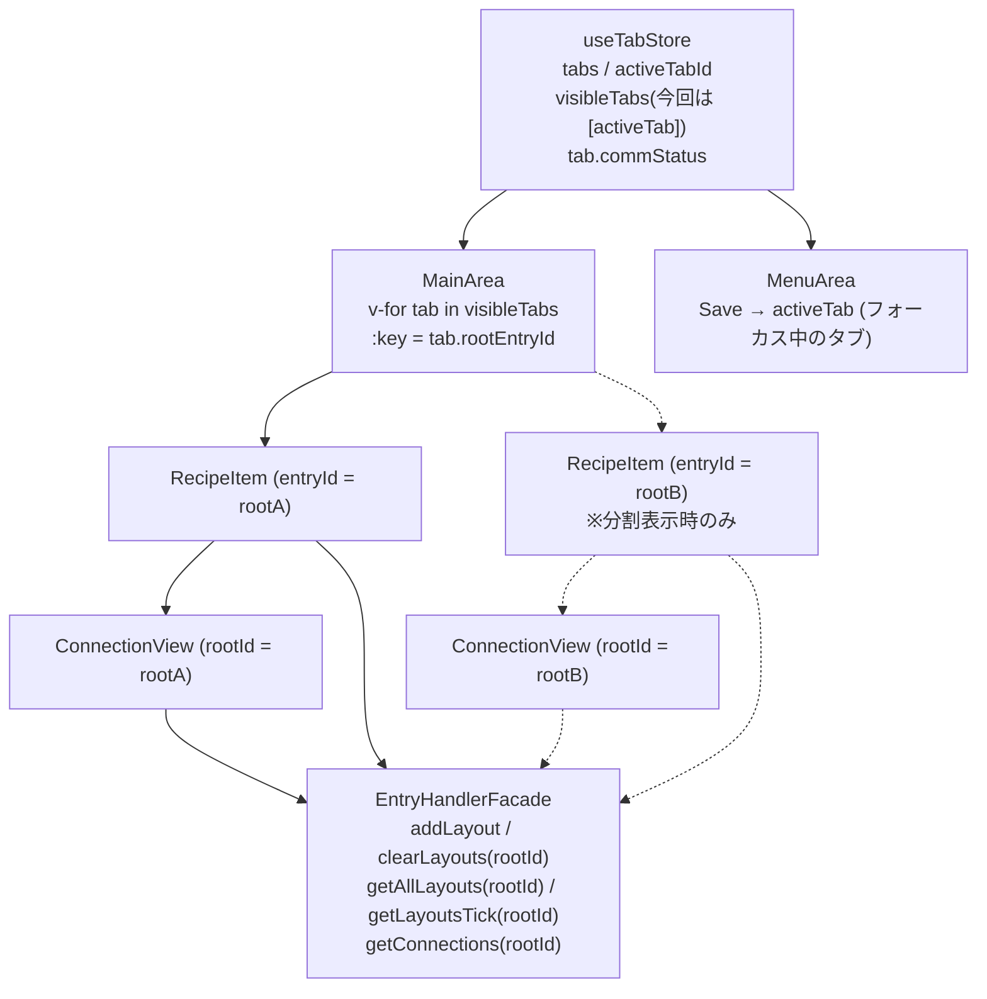

# Multi-Tab Support for MainArea

> Status: 要件定義・設計検討中(未実装)。作成日 2026-09-08。

## Functional Requirements

- MainAreaのタブを最大10個まで作成可能とする。
- 各タブの右端にxボタンを配置する。
- タブバーの最も右側に配置されるタブの隣に+ボタンを配置する。
- +ボタンがクリックされたらタブを新規作成する。タブが作成されるとルートエントリ及び通信ソケットを新規に作成しタブに対応させる。
- xボタンがクリックされたらタブを削除する。タブが削除されると対応するルートエントリ及び通信ソケットも削除される。
- メニューエリアのLoadボタン押下によりレシピをロードすると、新規にタブ作成してそこにレシピをロードする。タブが10個作成されている場合、Loadボタンは無効化される。
- メニューエリアのSaveボタンを押してレシピを保存する場合、選択されているタブのレシピを保存する。タブが選択されていない場合、Saveボタンは無効化される。

## Background: Current Code Structure

- [MainArea.vue](../../client/components/MainArea.vue) の `.tab-bar` はタブ1個分のHTML(ラベル "Recipe" 固定)が書かれているだけで、タブの配列やアクティブタブという状態は存在しない。ルートエントリは**MainAreaの`setup()`で1回だけ** `entryManager.addEntry('container', 'root-container')` → `moveEntry(rootEntryId, null, 0)` → `setComm(rootEntryId)`(既定の通信設定を登録)の順で生成され、その`rootEntryId`がpropとして単一の`RecipeItem`に渡される。
- [RecipeItem.vue](../../client/components/RecipeItem.vue) は `entryId` を必須propとして受け取る形になっており、自分ではルートを生成しない。Run/Communication Settingボタン、`getHierarchyTick(props.entryId)`の監視はこのpropのrootIdに対して動作する。ただしClearボタンのハンドラ`clearRecipe()`は `entryManager.clearEntries()` を引数なしで呼んでおり、propのrootIdを使っていない。また`measureEntries()`は`entryManager.clearLayouts()`でレイアウト情報を全エントリ分クリアしてから自分のパネル内のエントリだけを再登録する。
- [EntryHierarchyHandler.js](../../client/ecs/component-handlers/internal/EntryHierarchyHandler.js) の `setRoot`/`unsetRoot`/`isRoot`/`getRootOf`/`getHierarchyTick` は複数ルートを内部的に保持できる設計で、`__tests__/EntryHandlerFacade.test.js` に2ルート並行運用のテスト(`describe('EntryHandlerFacade.removeEntry')`のルート削除時に他ルートが残るケース、`describe('EntryHandlerFacade root entries')` の2ルート/`getRootOf`/ルート別の連番、`describe('EntryHandlerFacade.getHierarchyTick')` のルート別のhierarchy tick)が既にある。`ContainerChildren.vue`の`children` computedも`getRootOf()`経由で所属ルートのtickを監視している。
- ただし `EntryHandlerFacade.getRoot()`は「最初に登録されたルート」を返し、`EntryHandlerFacade.clearEntries()`も内部でその`getRoot()`を暗黙に使う。同様に `entryManager.getRoot()` を直接呼んでいる箇所が以下にあり、いずれもrootIdを引数で選べない。
  - `RecipeSerializer.buildRecipe()`
  - `RecipeDeserializer.restoreRecipe()`
  - `MenuArea.vue`の`onLoadRecipe()`(Load前の上書き確認で「現在のレシピが空か」を判定)
  - `ExecutionLogView.vue`の`transformedLogs` computed(ルートコンテナ自身の実行行をログ表示から除外する判定)
- 接続(connection)はルートを問わず1つのストアに入っており、`EntryHandlerFacade.getConnections()`は全ルート分を返す。`RecipeSerializer.buildRecipe()`はこれをそのまま`connections`として保存し、`ConnectionView.vue`の`connectionsWithLanes` computedも全接続を描画対象にする。`RecipeDeserializer.restoreRecipe()`が返す`connectionCount`も全ルート分の件数になる。
- 通信設定は ECS の `comms` コンポーネント(`EntryHandlerFacade.getComm()`/`setComm()`)としてエントリ単位で保持され、`World.despawn()`で他コンポーネントと一緒に削除される。実際のソケットは `EntryExecutionService` の `_entrySocketMap`(`entryId -> { socketId }`)で管理され、`EntryExecutionService.createComm(entryId, host, port)`/`deleteComm(entryId)`がホスト側(Electron IPC `socket:create`/`socket:destroy`、Web版 `POST /api/sockets`・`DELETE /api/sockets/:id`)に依頼する。`CommSettingView` には`entryId`(=rootEntryId)が渡され、`socketId`にもそのentryIdが使われる。**ソケットは既にentryId(ルート)単位で複数持てる設計**。
- スクリプト実行子プロセスは [RunnerHostRegistry.js](../../shared/RunnerHostRegistry.js) により**ルートのentryId単位で既に分離済み**。`ScriptRunnerHost`(1インスタンス=1子プロセス、JS/Pythonの切替はAppSettingsで決まるアプリ共通設定)を`Map<entryId, ScriptRunnerHost>`で保持し、`get(entryId)`で遅延生成する。`EntryExecutionService`はスクリプト実行時に`getRootOf(entryId)`で所属ルートを解決して渡し(`EntryExecutionService._executeBlock()`)、`electron/main.js`のIPCハンドラ(`script:execute`/`socket:create`/`socket:destroy`)・`server/api.js`のルート(`POST /scripts/:name/execute`/`POST /sockets`/`DELETE /sockets/:id`)がそのentryIdで`runnerRegistry.get(entryId)`を引く。ソケット作成/破棄も同じルートのプロセスにルーティングされる。
  - ただし`RunnerHostRegistry.shutdown(entryId)`(1ルート分のプロセス終了)を呼ぶ経路は無く、現状呼ばれているのはアプリ/サーバ終了時の`shutdownAll()`のみ(`electron/main.js`の`before-quit`ハンドラ、`server/index.js`の`shutdown()`)。レンダラからルート単位でプロセス終了を依頼するIPC/HTTP APIは存在しない。
- `useSystemState.js` の `isExecuting` / `selectedEntryId` / `connectingSource` / `showLog` / `lastError` はいずれもモジュールレベルの単一 `ref` で、アプリ全体でただ1つ共有されている。`executingRootEntryId` も追加されているが、値が入るのは`useEntryOperation.executeEntry()`経由のみで、`useEntryOperation.saveRecipe()`/`loadRecipe()`内の`setExecuting(true)`ではnullのまま。現状この値を参照している箇所は無い。`ExecutionLogService` の実行履歴ツリーもインスタンス単一。

## Design Considerations

### 1. ルートエントリ/レシピ操作APIのタブ(rootId)対応化 [resolved]

現状 `EntryHandlerFacade.clearEntries()` / `RecipeSerializer.buildRecipe()` / `RecipeDeserializer.restoreRecipe()` はいずれも内部で`getRoot()`を呼び「暗黙に最初のルートを対象にする」実装であり、複数タブ(複数ルート)を扱うにはrootIdを明示的に渡せるようにする変更が必須になる。`EntryPersistanceService.saveRecipe()`/`loadRecipe()`・`useEntryOperation.saveRecipe()`/`loadRecipe()`もrootIdを受け取る口が無いため、同様に引数を通す必要がある。

また接続ストアがルート共通であるため、`buildRecipe()`が全ルートの接続を保存してしまう問題がある(タブ1つの現状では顕在化しない)。

**検討した選択肢:**
- (A) `clearEntries(rootId)` / `buildRecipe(rootId)` / `restoreRecipe(data, rootId)` のように**必須**のrootId引数を追加し、呼び出し元が`useTabStore`の`activeTab.rootEntryId`を明示的に渡す
- (A') (A)と同様だがrootIdを省略可能とし、省略時は`getRoot()`(最初のルート)にフォールバックする
- (B) シグネチャは変えず、`getRoot()`がタブストアの設定する「アクティブなルート」を返すようにする

**決定:** (A)を採用し、rootIdは**必須引数**とする。どのルートを操作するかが呼び出し側で明示され、テストしやすく、`EntryHierarchyHandler`の既存の複数ルート対応とも整合する。(A')は既存の呼び出し元・テストを変更せずに済むが、rootIdを渡し忘れた呼び出しが黙って最初のタブを操作してしまい、発見しにくいバグになるため不採用。(B)は差分が小さいが、ECSがUI状態(アクティブタブ)に依存し、操作対象が暗黙のグローバル状態で決まるため別タブを保存/クリアする事故を招きやすく不採用とした。

**API変更:**

| 層 | 変更前 | 変更後 |
|---|---|---|
| `EntryHandlerFacade` | `clearEntries()` | `clearEntries(rootId)` |
| `RecipeSerializer` | `buildRecipe()` | `buildRecipe(rootId)` |
| `RecipeDeserializer` | `restoreRecipe(data)` | `restoreRecipe(data, rootId)`(内部の`clearEntries()`・`deleteComm()`にも同じrootIdを渡す) |
| `EntryPersistanceService` | `buildRecipe()` / `restoreRecipe(data)` / `saveRecipe(name)` / `loadRecipe()` | `buildRecipe(rootId)` / `restoreRecipe(data, rootId)` / `saveRecipe(rootId, name)` / `loadRecipe(rootId)` |
| `useEntryOperation` | `saveRecipe()` / `loadRecipe()` | `saveRecipe(rootId)` / `loadRecipe(rootId)` |

- rootIdが渡されない、またはルートでないIDが渡された場合は(`isRoot(rootId)`で検証し)例外を投げる。暗黙のフォールバックは行わない。
- `getRoot()`自体は「最初に登録されたルートを返す」実装のまま残すが、アプリコード(コンポーネント・サービス)からは呼ばない。用途は既存テスト内の参照など、単一ルートであることが自明な箇所に限る。

**呼び出し元の対応:**
- **Save(MenuArea)**: `useTabStore().activeTab.rootEntryId`を`saveRecipe(rootId)`に渡す(`activeTab === null`ならSaveボタンは無効化済み。セクション2参照)。
- **Load(MenuArea)**: `useTabStore().createTab()`で新規タブを作成し、返された`tab.rootEntryId`を`loadRecipe(rootId)`に渡す。新規タブにロードするため、`MenuArea.vue`の`onLoadRecipe()`にある「現在のレシピが空か」による上書き確認は不要になる(この`getRoot()`呼び出しは削除)。ファイル選択がキャンセルされた場合にタブを残すか閉じるかはセクション6の不明点として扱う。
- **Clear(RecipeItem)**: 既に持っている`props.entryId`を`clearEntries(props.entryId)`に渡す(`RecipeItem.vue`の`clearRecipe()`)。
- **ExecutionLogView**: ログは全タブ共通(セクション4参照)のため、`ExecutionLogView.vue`の`transformedLogs`内の`getRoot()`との比較を「`useTabStore().tabs`のいずれかの`rootEntryId`と一致するか」の判定に置き換える(`entryManager.isRoot(entryId)`でも同等)。

**接続のルート別フィルタ:**
- `buildRecipe(rootId)`は、接続の両端が`getRootOf(endpoint.entryId) === rootId`を満たすものだけを`connections`として保存する。
- `RecipeDeserializer`の`connectionCount`も同様に、そのルートに属する接続のみを数える。
- `ConnectionView.vue`も親のRecipeItemからprop `rootId`で渡されたルートに属する接続のみを描画対象とする(セクション3参照)。

**テストへの影響:** `EntryPersistanceService.test.js`など既存テストの`buildRecipe()`/`restoreRecipe(recipe)`/`clearEntries()`呼び出しはrootIdを渡す形に更新する。あわせて、2ルートを作成し「片方のルートだけが保存/クリア/復元され、他方のルートとその接続は影響を受けない」ことを検証するテストを追加する。

### 2. タブ状態(タブ一覧・アクティブタブ)をどこで管理するか [resolved]

タブID・ラベル・対応する`rootEntryId`の一覧、およびどのタブがアクティブかという状態は現在どこにも存在しない。MenuArea(Load/Saveボタンの有効・無効判定に必要)とMainArea(タブバー描画に必要)をはじめ、RecipeItem・ExecutionLogView・ConnectionView・`useEntryOperation`など複数のモジュールから参照される。

**検討した選択肢:**
- (A) 専用のグローバルなタブストアを新設し、タブ一覧・アクティブタブとタブ作成/削除処理を集約する
- (B) MainAreaのローカル状態とし、MenuAreaへはprops/イベントまたはprovide/injectで受け渡す
- (C) ECS(`EntryHierarchyHandler`のルート一覧)からタブ一覧を導出し、`activeRootId`のみ保持する

**決定:** (A)を採用し、**Pinia**のストア `useTabStore` として実装する。タブ状態は複数モジュールから参照されるため、`useSystemState.js`のような独自のモジュールレベル`ref`ではなく、Vue公式の状態管理ライブラリであるPiniaで管理する。(B)は兄弟コンポーネント間(MainArea/MenuArea)でのバケツリレーやLoad時のタブ作成コールバックが必要になり、(C)はラベルやタブ単位のUI状態(Comm状態・スクロール位置)をECSに持たせられず、ルートの並び順も保証されないため不採用とした。

**導入作業:**
- `pinia`を`dependencies`に追加し、`client/main.js`で`app.use(createPinia())`を登録する(既存の`app.provide(...)`より前)。
- ストアは`client/stores/useTabStore.js`に配置する(ファイル名はエクスポートする`useTabStore`と一致させる)。
- ユニットテストでは各テストの`beforeEach`で`setActivePinia(createPinia())`を呼び、テスト間で状態をリセットする(モジュールレベル`ref`の手動リセットが不要になる)。

**ストアの構成(Setup Store形式):**

```js
// client/stores/useTabStore.js
export const useTabStore = defineStore('tab', () => {
  const entryManager = inject('entryManager')
  const entryExecutionService = inject('entryExecutionService')

  // state
  const tabs = ref([])            // [{ id, label, rootEntryId, commStatus }]
  const activeTabId = ref(null)

  // getters
  const activeTab = computed(() => tabs.value.find(t => t.id === activeTabId.value) ?? null)
  const visibleTabs = computed(() => activeTab.value ? [activeTab.value] : []) // セクション3。分割表示時はpanesから導出
  const isTabLimitReached = computed(() => tabs.value.length >= MAX_TABS) // MAX_TABS = 10

  // actions
  function createTab(label) { /* addEntry → moveEntry(id, null, 0) → setComm(id) → tabs.push → activeTabId 更新 */ }
  async function closeTab(tabId) { /* deleteComm → shutdownRunner → removeEntry → tabs から除去 → アクティブだった場合は tabs[0] ?? null に付け替え(セクション6) */ }
  function setActiveTab(tabId) { /* activeTabId 更新(null 可。変化時は resetState()。セクション4) */ }
  function getTabByRootId(rootId) { /* rootEntryId からタブを引く(セクション3) */ }
  function setCommStatus(rootId, status) { /* 該当タブの commStatus 更新(セクション3) */ }

  return { tabs, activeTabId, activeTab, visibleTabs, isTabLimitReached, createTab, closeTab, setActiveTab, getTabByRootId, setCommStatus }
})
```

- **state**: `tabs`(`{ id, label, rootEntryId, commStatus }`の配列)と`activeTabId`。`commStatus`はセクション3でRecipeItemのローカル`commBtnStatus`から移管したもの。その他のタブ単位のUI状態(セクション6のスクロール位置など)が必要になった場合も、タブ要素のフィールドとしてこのストアに追加する。
- **getters**: `activeTab`、`visibleTabs`(セクション3)、`isTabLimitReached`。MenuAreaは`isTabLimitReached`でLoadボタンを、`activeTab === null`でSaveボタンを無効化する。
- **actions**:
  - `createTab(label)`: 現在`MainArea.vue`の`setup()`にあるルート生成処理(`entryManager.addEntry('container', 'root-container')` → `moveEntry(id, null, 0)` → `setComm(id)`)をここに移し、タブを`tabs`に追加して作成した`tab`を返す。上限到達時は何もせず`null`を返す。+ボタン(MainArea)とLoad(MenuArea → `useEntryOperation.loadRecipe()`)の両方がこのアクションを呼ぶ。
  - `closeTab(tabId)`: セクション5の順序(`deleteComm(rootId)` → `shutdownRunner(rootId)` → `removeEntry(rootId)` → `tabs`から除去 → アクティブタブの付け替え)でタブを削除する。閉じたタブがアクティブだった場合は残りの最も左のタブ(`tabs[0]`)を、残りが0個なら`null`をアクティブにし、非アクティブタブを閉じた場合はアクティブタブを変えない(セクション6)。`deleteComm`/`shutdownRunner`が失敗してもエラーをログに出して以降の処理を続行する(セクション5)。
  - `setActiveTab(tabId)`: アクティブタブを切り替える。`activeTabId`が変わる場合は`useSystemState().resetState()`で選択状態・パラメータ接続中状態をクリアする(セクション4)。`createTab()`/`closeTab()`でのアクティブタブの付け替えもこのアクションを経由する。
  - `getTabByRootId(rootId)` / `setCommStatus(rootId, status)`: RecipeItemが自分の`entryId`からタブを特定し、Comm状態を参照・更新するために使う(セクション3)。
- **依存サービスの取得**: `entryManager`・`entryExecutionService`は`client/main.js`で`app.provide()`されているため、Setup Store内で`inject()`して取得する(Vue 3.3+ / Pinia 2.1+ではストア初期化がアプリのinjectionコンテキスト内で行われる。本リポジトリのVueは3.5系)。ユニットテストでは`createApp().provide(...)`+`app.use(pinia)`でモックを注入する。
- **ECSとの整合**: ルートの生成・削除は必ず`createTab()`/`closeTab()`経由で行い、コンポーネントから直接`addEntry`/`removeEntry`でルートを増減させないことで、`tabs`とECSのルート一覧の不整合を防ぐ。

0タブの許容(`activeTabId`は`null`になり得る)と削除後のアクティブタブの付け替えはセクション6で決定済み。新規タブを作成直後にアクティブにするかは、セクション6の不明点として引き続き確認する。

### 3. RecipeItemコンポーネントの複数タブ対応 [resolved]

`RecipeItem.vue`は既に`entryId`(rootId)をpropで受け取る形になっており、ルート生成の責務は呼び出し元(現状MainArea)にある。したがって「インスタンス化するたびにルートが増える」問題は既に解消済みで、残る論点はタブ切替時のインスタンスの扱いのみ。

**論点:** タブ切替時にRecipeItemインスタンスをどう扱うか。

**追加要件(将来):** 将来、複数のタブ(少なくとも2つ)を同時に表示できるようにしたい(画面分割表示)。今回の実装は1タブ表示のままでよいが、分割表示を後から追加する際にRecipeItem・レイアウト管理・`useTabStore`の作り直しが発生しない構造にしておく。

**現状の実装で「2つのRecipeItemを同時にマウントできない」要因:**
- **レイアウトストアがアプリ全体で1つ**: `RecipeItem.vue`の`measureEntries()`は`entryManager.clearLayouts()`で**全エントリ分**のレイアウトを消してから自パネル内のエントリだけを再登録する。2インスタンスあると互いのレイアウトを消し合い、片方の接続線・背景線が消える。また`EntryHandlerFacade.layoutsTick`も1つなので、片方の再計測でもう片方の`entryLayoutMap`/`ConnectionView`まで再計算される。
- **`entryLayoutMap`がルートを区別しない**: `RecipeItem.vue`の`entryLayoutMap` computed(背景線)は`getAllLayouts()`(全ルート分)を描画するため、別ペインのエントリ位置に背景線が引かれる。
- **`ConnectionView`がルートを区別しない**: `ConnectionView.vue`の`connectionsWithLanes` computedは`getConnections()`で全ルートの接続を対象にし、`getLayout()`は全ルート共通のストアを引く。propも持たないため、どのルートを描くかを指定できない。
- **`commBtnStatus`が`RecipeItem.vue`のローカル`ref`**: 再マウントで消える。

**検討した選択肢:**
- (a) タブごとに1つのRecipeItemを`v-for`で生成し、非アクティブなものは`v-show`で隠す(常時マウント)
- (b) アクティブな1インスタンスのみマウントし、`:key="activeTab.rootEntryId"`で`rootEntryId`をpropで渡し直す(タブ切替時に再マウント)
- (c) **「表示中のタブ」の分だけRecipeItemをマウントする**。`useTabStore`に`visibleTabs`(表示中タブの配列)を持たせ、MainAreaは`v-for="tab in visibleTabs" :key="tab.rootEntryId"`で描画する。今回は`visibleTabs = [activeTab]`(要素数1)なので挙動は(b)と同じだが、RecipeItem以下を「自分のrootIdの範囲だけを扱う」実装に揃えておき、分割表示時は`visibleTabs`が2要素以上を返すだけで済むようにする

| 案 | 今回(1タブ表示)のコスト | 分割表示への拡張 |
|---|---|---|
| (a) | 最大10インスタンスのwatcher常駐。レイアウトストアのルート別分離が必須 | 「どれを`v-show`するか」をペインごとに管理する必要があり、結局(c)と同じ状態管理が要る |
| (b) | 最小(現状のレイアウト実装のまま動く) | レイアウトストア・`ConnectionView`・背景線がアプリ全体で1つという前提に依存するため、分割表示時にRecipeItem以下とECSのレイアウト処理を作り直すことになる |
| (c) | (b)+レイアウトのルート別分離・`ConnectionView`のrootId化(いずれも小規模) | MainAreaのテンプレートとストアの`visibleTabs`の中身を変えるだけ。RecipeItem以下は変更不要 |

**決定:** (c)を採用する。分割表示を前提にすると、(b)のままでは「RecipeItemは画面に1つだけ」という前提がレイアウト管理・接続描画に埋め込まれ、後から外すコストが大きい。(c)は今回(b)と同じくマウントされるのは1インスタンスで実行時コストも同じだが、ルート単位で閉じた実装にしておくことで、分割表示の追加をMainAreaとストアに局所化できる。(a)は最大10インスタンス分のwatcherが常駐するうえ、レイアウトストアのルート別分離は(c)と同様に必要で、分割表示時にはペインごとの表示状態管理も結局必要になるため不採用。(b)は今回の差分は最小だが、分割表示の追加時にRecipeItem以下とECSのレイアウト処理の作り直しが発生するため不採用とした。

タブ切替時のスクロール位置のリセットを許容するかは、(c)の構造に影響しない(必要になればタブ要素のフィールドとして`useTabStore`に追加するだけで済む)ため、引き続きセクション6の不明点として扱う。



**今回の実装で行う変更:**
1. **レイアウトストアのルート別分離(`EntryHandlerFacade`)**
   - `EntryLayoutComponent`に`rootId`を持たせ、`addLayout(entryId, y, height)`は登録時に`getRootOf(entryId)`でrootIdを記録する。
   - `clearLayouts(rootId)`は指定ルートのレイアウトのみ削除する。`getAllLayouts(rootId)`も指定ルート分のみ返す。セクション1と同じ方針でrootIdは**必須**とし、省略時のフォールバックは行わない。
   - `layoutsTick`(単一)を`getLayoutsTick(rootId)`(ルート別のtick。`getHierarchyTick(rootId)`と同じ作り)に置き換え、あるルートの再計測が他ルートの表示を再計算させないようにする。ルート削除時(`removeEntry(rootId)`)はtickも破棄する。
   - `getLayout(entryId)`はエントリIDで一意に引けるため変更しない。
2. **RecipeItem**: `measureEntries()`は`clearLayouts(props.entryId)`を呼ぶ。`entryLayoutMap`は`getLayoutsTick(props.entryId)`/`getAllLayouts(props.entryId)`を参照する。`ConnectionView`には`:root-id="entryId"`を渡す。
3. **ConnectionView**: `rootId`をprop(`{ type: String, required: true }`)で受け取り、`getRootOf(endpoint.entryId) === rootId`を両端が満たす接続のみを描画する(セクション1の接続フィルタと同じ条件。`EntryHandlerFacade.getConnections(rootId)`として共通化し、`buildRecipe(rootId)`・`connectionCount`からも使う)。tickは`getLayoutsTick(rootId)`を参照する。
4. **`commBtnStatus`のストア移管**: タブ要素に`commStatus`(`'none' | 'connected' | 'failed'`)を持たせ、RecipeItemは`entryId`から自分のタブを引いて表示・更新する(`useTabStore`に`getTabByRootId(rootId)`/`setCommStatus(rootId, status)`を追加)。RecipeItemは「アクティブタブ」ではなく**自分のprop `entryId`**でタブを特定する。分割表示時に2つのRecipeItemが共存しても互いの状態を参照しない。
5. **`useTabStore`への追加(セクション2の構成に対する追記)**
   - getter `visibleTabs`: 今回は`activeTab ? [activeTab] : []`を返す。
   - MainAreaは`visibleTabs`だけを見てRecipeItemを描画し、`activeTab`を直接参照しない。`activeTab`は「フォーカス中のタブ」(Save対象・タブバーのハイライト)の意味で使う。
6. **MainArea**: `<RecipeItem v-for="tab in visibleTabs" :key="tab.rootEntryId" :entry-id="tab.rootEntryId" />`とする。コンテナはflexレイアウトにしておき、要素数が増えたら横に並ぶようにする(今回は1要素なので見た目は変わらない)。

**RecipeItem以下の実装ルール(分割表示に備えて):** RecipeItemとその子孫(`ContainerChildren`・`ConnectionView`など)は、操作対象のルートを`props.entryId`(または`getRootOf()`)だけから決め、`useTabStore().activeTab`を参照しない。アクティブタブを参照してよいのはMenuArea(Save)・MainArea(タブバー)・`useTabStore`自身に限る。

**分割表示を実装する際に別途検討する事項(今回はスコープ外):**
- **ペインの表現**: `useTabStore`に`panes`(`[{ id, tabId }]`)と`focusedPaneId`を追加し、`visibleTabs`を`panes`から導出、`activeTab`をフォーカス中ペインのタブとする。タブバーをペインごとに持つか、1本のタブバーから各ペインに割り当てるかはUI設計時に決める。今回の`visibleTabs`/`activeTab`の使い分けを守っていれば、この変更はストアとMainAreaに閉じる。
- **ペイン間のドラッグ&ドロップ**: 現状の`ContainerChildren.vue`のドロップコールバック(`setOnDropCallback`)内の`moveEntry()`はルートを跨ぐ移動を制限していないため、分割表示ではペインAのエントリをペインBにドロップできてしまう。ルートを跨ぐ移動を禁止するか、許可して(コピーとして扱う/移動元の接続を削除する等)扱うかを決める必要がある。
- **ルートを跨ぐパラメータ接続**: `connectingSource`(`useSystemState`)はアプリ共通のため、ペインAで接続を開始してペインBのパラメータをクリックできてしまう。接続作成時に両端の`getRootOf()`が一致することを検証して拒否する必要がある。
- **アプリ共通のグローバル状態**: `isExecuting`による`.executing`のdim overlayはMainArea全体にかかるため、片方のペインの実行中はもう片方も操作できない。`selectedEntryId`も全ペインで1つ。これらはセクション4で採用した「アプリ全体で1つ」の方針の見直し(タブ単位ロック等。セクション4でスコープ外とした事項)と合わせて検討する。
- **スクロール位置**: 分割表示でも、ペイン内でタブを切り替えるとRecipeItemは再マウントされスクロール位置は先頭に戻る(セクション6の不明点と同じ)。

### 4. アプリ全体で共有されているグローバル状態の扱い [resolved]

`isExecuting`(実行中ロック)、`selectedEntryId`(選択状態)、`connectingSource`(パラメータ接続中状態)、`lastError`、`ExecutionLogService`の実行履歴は現状すべて「アプリ全体でただ1つ」。複数タブ化すると以下の挙動になる。
- 実行中ロック: タブAで実行中の間、タブBのRun/Load/Saveボタンも無効化される(MainArea全体に`.executing`のdim overlayがかかるため、タブバーの切替・+/xボタンも操作不可になる)。
- 選択状態/接続中状態: RecipeItemのhierarchy tick監視で`cancelConnection()`/選択解除が行われるが、タブ切替そのものでは解除されない。別タブのentryIdなので実害は小さい(表示上は何も選択されていないように見える)が、タブ切替時に`resetState()`を呼んでおくのが安全。
- 実行ログ: 全タブの実行ログが1つのログパネルに混在して表示される。

**検討した選択肢:**
- (A) 現状通り「アプリ全体で1つ」の挙動を維持する
- (B) 実行ロックをタブ単位にし、実行ログもタブ別にフィルタする(本機能で対応)

**決定:** (A)を採用する。今回の機能要件は「タブの作成・削除・Load/Save」に閉じたスコープなので、実行ロックやログのタブ単位分離は本機能のスコープ外とし、`isExecuting`・`selectedEntryId`・`connectingSource`・`lastError`・`ExecutionLogService`の実行履歴はいずれもアプリ全体で1つのまま変更しない。スクリプト実行プロセスは既にルート単位で分離されている(前提参照)ため、将来タブごとの分離が必要になった場合も、ボトルネックはUI側のロック/ログのみで、既存の`executingRootEntryId`をタブ単位ロックの起点にできる。(B)はタブ間の並列操作が可能になりセクション3の分割表示とも相性が良いが、`useSystemState`・MainAreaのoverlay・`ExecutionLogView`・`useTabStore.closeTab()`(実行中タブの削除への対応が必要になる)まで改修範囲が広がるため、本機能では不採用とした。

**本方針に基づく挙動:**
- **実行中ロック**: タブAで実行中の間はMainArea全体に`.executing`のdim overlayがかかり、タブBのRun/Load/Save、タブ切替、+/xボタンも操作不可となる。これは仕様として許容する。セクション5で実行中のタブ削除を考慮しないのはこのロックを前提としている。
- **実行ログ**: 全タブの実行ログを1つのログパネルに混在して表示する。ルートコンテナ自身の実行行の除外判定は全タブの`rootEntryId`に対して行う(セクション1の`ExecutionLogView`の対応)。
- **タブ切替時の状態リセット**: アクティブタブが変わる際に`useSystemState().resetState()`(`cancelConnection()` + `clearSelection()`)を呼び、別タブのエントリに対する選択状態・パラメータ接続中状態が残らないようにする。呼び出しは`useTabStore.setActiveTab()`に集約し、`activeTabId`が実際に変わる場合のみ行う。`createTab()`/`closeTab()`によるアクティブタブの付け替えも`setActiveTab()`経由で行うことで、同じリセットが適用される。`useSystemState`は内部で`inject('entryManager')`するが、ストアの他の依存と同じくSetup Store内で取得できる(セクション2)。`lastError`はリセット対象に含めない(現状の`resetState()`の範囲のまま)。
- **テスト**: `useTabStore.setActiveTab()`で別タブに切り替えると`selectedEntryId`/`connectingSource`がクリアされ、同じタブを指定した場合はクリアされないことを検証する。

**スコープ外(別の設計検討として切り出す):** タブ単位の実行ロック(タブAの実行中もタブBを操作可能にする)、ログのタブ別フィルタ、それに伴う実行中タブの削除処理。セクション3の分割表示で別途検討する事項(アプリ共通のグローバル状態の見直し)と合わせて検討する。

### 5. タブ削除時のソケット/ルート/子プロセス削除 [resolved]

- **ルート**: `EntryHandlerFacade.removeEntry(entryId)`は対象がルート自身の場合に`hierarchyHandler.unsetRoot()`まで含めて処理し、配下エントリ・接続・パラメータ・`comms`コンポーネントも削除する(`__tests__/EntryHandlerFacade.test.js`の`describe('EntryHandlerFacade.removeEntry')`で他ルートが残ることも検証済み)。ルートの削除自体は追加改修なしで可能。
- **ソケット**: `RecipeDeserializer.restoreRecipe()`がLoad時に`entryExecutionService.deleteComm(rootId)`を呼んでいる既存パターンと同じ呼び方を、xボタン押下時のタブ削除処理でも踏襲すればよい(`useEntryOperation.releaseSocket(rootId)`経由でも可)。`removeEntry()`より先に呼ぶ。
- **子プロセス**: 前提のとおり、タブ(ルート)ごとの`ScriptRunnerHost`は`RunnerHostRegistry`に残り続ける。タブ削除時にプロセスを終了させないと、最大10個を超えて作成/削除を繰り返すたびにアイドルの子プロセスが蓄積する。`RunnerHostRegistry.shutdown(entryId)`自体は実装済みだが、レンダラからこれを呼ぶ経路が無い。

**検討した選択肢:**
- (A) ルート単位のランナー終了APIを明示的に追加し、`useTabStore.closeTab()`から呼ぶ
- (B) ホスト側の`socket:destroy`/`DELETE /api/sockets/:id`の処理の中でランナーも終了させる(新規APIなし)
- (C) `RunnerHostRegistry`にアイドルタイムアウト(一定時間未使用のホストを終了するGC)を持たせる(クライアント側の変更なし)

**決定:** (A)を採用する。プロセスのライフサイクルがタブの削除と1対1で明示的に対応し、テストもしやすい。(B)は新規APIが不要だが、プロセスの寿命をソケットに結びつけてしまう。ソケットを一度も有効にせずにスクリプトだけ実行したタブではプロセスがリークし、またLoad時の`deleteComm()`(`RecipeDeserializer.restoreRecipe()`)のたびにランナーが終了・再起動されてしまうため不採用。(C)はクライアントの変更が不要だが、終了タイミングが予測できず、ホストにタイマー処理が増え、開いたままのタブのランナー(`numpy`/`pandas`等の重いimportを済ませたもの。セクション7の注意点参照)を終了させてしまい得るため不採用とした。

**追加するAPI:**

| 層 | 追加内容 |
|---|---|
| Electron main(`electron/main.js`) | `ipcMain.handle('runner:shutdown', async (_evt, entryId) => ensureRunnerRegistry().shutdown(entryId))` |
| Electron preload(`electron/preload.js`) | `shutdownRunner: (entryId) => ipcRenderer.invoke('runner:shutdown', entryId)` |
| Web版(`server/api.js`) | `router.delete('/runners/:entryId', ...)`(= `DELETE /api/runners/:entryId`)。`runnerRegistry.shutdown(req.params.entryId)`を待ってから`{ shutdown: true }`を返す |
| クライアント(`ScriptExecutionService`) | `shutdownRunner(entryId)`。`createSocket()`/`destroySocket()`と同様にElectron/Web版を切り替えて上記を呼ぶ |
| クライアント(`EntryExecutionService`) | `shutdownRunner(entryId)`。`scriptExecutionService.shutdownRunner(entryId)`に委譲する(`useTabStore`は既に`inject`している`entryExecutionService`経由で呼ぶ。`createComm()`/`deleteComm()`と同じ経路) |

- **冪等性**: ホストは遅延生成のため、そのタブで一度もスクリプト実行/ソケット作成が行われていなければ`RunnerHostRegistry`にホストが存在しない。この場合は何もせず成功扱いとする(`RunnerHostRegistry.shutdown()`は既にホスト未登録時に`Promise.resolve()`を返す実装であり、そのまま使える)。同じentryIdに対する2回目以降の呼び出しも同様に無害とする。
- **`get()`を経由しない**: 終了APIは`runnerRegistry.get(entryId)`ではなく`runnerRegistry.shutdown(entryId)`を直接呼ぶ。`get()`はホストを遅延生成してしまうため、終了のためだけにホストを作ることになる。

**削除処理の順序(`useTabStore.closeTab(tabId)`):**
1. `entryExecutionService.deleteComm(rootId)`: ソケット記録(`_entrySocketMap`)を削除し、ソケットがあればホストに破棄を依頼する(ソケットが無ければ何もしないため、ここで子プロセスが起動されることは無い)。
2. `entryExecutionService.shutdownRunner(rootId)`: 当該ルートの子プロセスを終了する。
3. `entryManager.removeEntry(rootId)`: ルートと配下エントリ・接続・`comms`等を削除する。
4. `tabs`からタブを除去し、アクティブタブを付け替える(閉じたタブがアクティブだった場合は残りの最も左のタブ、残りが0個なら`null`。セクション6で決定)。

- **エラー時の扱い**: 1・2のホスト側処理が失敗(IPC/HTTPエラー)しても、エラーをログに出したうえで3・4を続行する。ホスト側の失敗でタブが閉じられなくなる状態を作らないためである。プロセスが終了できずに残った場合も、アプリ/サーバ終了時の`shutdownAll()`で最終的に回収される。
- **実行中のタブ削除**: セクション4の方針(実行ロックはアプリ全体で1つ)により、実行中はMainArea全体に`.executing`のdim overlayがかかりxボタンを押せないため、実行中のランナーを終了させるケースは今回考慮しない。タブ単位ロックを導入する場合は、実行中タブのxボタン無効化と合わせて再検討する。

**テスト:**
- `RunnerHostRegistry`: `shutdown(entryId)`が対象ホストのみ終了し他のホストが残ること、未登録のentryIdで何もしないことを検証する(既存テストが無ければ追加)。
- `server/api.js`: `DELETE /api/runners/:entryId`が`runnerRegistry.shutdown()`を呼び、未登録のentryIdでも成功を返すことを検証する。
- `useTabStore.closeTab()`: `deleteComm` → `shutdownRunner` → `removeEntry`の呼び出し順序、および`shutdownRunner`が失敗しても`removeEntry`とタブ除去が行われることを、モックした`entryExecutionService`/`entryManager`で検証する。

### 6. その他の不明点(要確認) [undecided]

- **「通信ソケットを新規に作成」の意味**: 現状ソケットは`CommSettingView`でユーザーがホスト/ポートを入力し`useTcpIp`を有効にして初めて`EntryExecutionService.createComm()`が呼ばれる(ホスト側でTCP接続を実際に張る)仕組み。タブ作成時に行うのは`setComm(rootId)`による既定の通信設定(`comms`コンポーネント)の登録のみで、接続先情報は無い。要件文言の「通信ソケットを新規に作成」は「タブ(ルート)ごとに独立した通信設定・ソケット管理単位(entryIdに紐づく)を用意する」という意味であり、タブ作成時に実際にTCP接続を試みるわけではないと解釈している。この理解で正しいか確認したい。
- **タブ削除時の確認ダイアログ**: Loadボタン押下時は既存レシピの上書きを`window.confirm`で確認しているが、タブ削除(xボタン)については要件に確認の有無が書かれていない。未保存の変更が失われる可能性がある点は同様なので、確認ダイアログを出すべきか。
- **全タブ削除後(0タブ)の扱いとタブ削除後のアクティブタブ [resolved]**:
  - 選択肢:
    - (A) 0タブを許容し、MainAreaに空状態(メッセージと+ボタン)を表示する
    - (B) 最低1タブは常に残す(最後の1つのxボタンを無効化する、または閉じたら空の新規タブを作る)
  - **決定:** (A)を採用する。要件(全タブにxボタンを配置する、タブ未選択時はSaveボタンを無効化する)をそのまま満たし、`activeTab === null`はセクション1〜3で既に考慮済み(Save無効化、`visibleTabs = []`)のため追加の分岐が少ない。(B)は「タブ未選択時のSave無効化」が発生し得なくなり、最後のタブのxボタンだけ挙動が異なるため不採用とした。
  - **0タブの許容**: 最後のタブも含めて全てのxボタンを有効とし、全タブを閉じた場合は`activeTabId = null`とする。`useTabStore.setActiveTab()`は`null`を受け付ける(`null`への変化時も`resetState()`を呼ぶ。セクション4)。
  - **0タブ時のMainArea**: `visibleTabs`が空のためRecipeItemはマウントされない。タブバーには+ボタンのみを表示し、本体領域には空状態のメッセージ(例: 「+ボタンまたはLoadでタブを作成してください」)を表示する。MenuAreaのSaveボタンは`activeTab === null`で無効化され、Loadボタンは有効のまま(Loadは新規タブを作成するため)。
  - **起動時**: 現状の挙動(起動直後に空のレシピが1つ表示される)を維持するため、MainAreaの`setup()`で`useTabStore().createTab()`を1回呼び、タブを1つ作成した状態で起動する(現在`setup()`にあるルート生成処理はセクション2のとおり`createTab()`に移る)。
  - **タブ削除後のアクティブタブ**: アクティブ(選択中)のタブを閉じた場合は、残ったタブのうち**最も左のタブ**(`tabs[0]`)をアクティブにする。残りが0個なら`null`とする。アクティブでないタブを閉じた場合はアクティブタブを変更しない。付け替えは`setActiveTab()`経由で行う(セクション4)。
  - **テスト**: `useTabStore.closeTab()`について、(1) アクティブタブを閉じると残りの最も左のタブがアクティブになること(閉じたタブが先頭・中間・末尾のいずれでも`tabs[0]`になる)、(2) 非アクティブタブを閉じてもアクティブタブが変わらないこと、(3) 最後の1タブを閉じると`tabs`が空・`activeTabId === null`・`visibleTabs`が空になること、を検証する。
- **タブのラベル**: 新規作成タブのデフォルトラベル(例: "Recipe 1"のような連番か、単に空白か)と、Loadでレシピをロードしたタブのラベル(レシピの`meta.name`やファイル名を使うか)をどうするか、要件に指定がない。
- **新規タブの初期表示**: +ボタンで作成したタブ、およびLoadで新規作成したタブは、作成後すぐにアクティブ(選択状態)にする想定でよいか。
- **Loadのファイル選択キャンセル時の新規タブ**: セクション1の方針ではLoad時に先に`createTab()`で新規タブを作成してから`loadRecipe(rootId)`を呼ぶ。ファイル選択がキャンセルされた場合やレシピの読み込みに失敗した場合、作成した空タブを`closeTab()`で閉じるか、空タブとして残すか(あるいはファイル選択後にタブを作成する順序にするか)。
- **タブ数上限に達した場合の+ボタン**: 要件はLoadボタンの無効化のみ明記しているが、タブが10個の状態で+ボタンも無効化するべきか(一貫性の観点では無効化が自然だが要件に明記がないため確認したい)。
- **タブ切替時のスクロール位置**: セクション3で採用した(c)案(今回の挙動は(b)と同じ)ではタブ切替のたびにRecipeItemが再マウントされ、レシピパネルのスクロール位置が先頭に戻る。これを許容してよいか(許容しない場合はタブごとにスクロール位置を`useTabStore`に保存・復元する)。

### 7. Per-Recipe Child Process Isolation (Implemented) and Remaining Issues [resolved]

当初は将来の検討事項としていたが、レシピ(ルート)単位の子プロセス分離は既に実装済みである。

**現状のアーキテクチャ**: `shared/ScriptRunnerHost.js`は1インスタンス=1子プロセス(JS: `shared/script-runner.js`、Python: `appdata/python/script_runner.py`。どちらを起動するかはAppSettingsの`script.interpreterName`によるアプリ共通設定)を管理し、TCP制御チャネル(`shared/SocketComm.js`)越しにリクエストcorrelation(`_pending` Map)を行う。`shared/RunnerHostRegistry.js`がこれを`Map<entryId(rootId), ScriptRunnerHost>`で保持し、`electron/main.js`/`server/index.js`はレジストリ経由で`get(entryId)`する。`ScriptRunnerHost._ensureConnection()`による遅延生成のため、タブ(ルート)を作っただけではプロセスは起動せず、そのルートで最初にスクリプト実行またはソケット作成が行われた時点で起動する。IPC(`script:execute`/`socket:create`/`socket:destroy`)とWeb版APIは既にentryId(rootId)を受け取るプロトコルになっている。

**採用したインスタンス設計**: 「単一インスタンスが内部で複数プロセスを管理する」案ではなく、`ScriptRunnerHost`をルートごとに複数生成し、ルーティングだけを外側の薄いレジストリ(`RunnerHostRegistry`)に切り出す案を採用している。1プロセス分のプロトコル管理とプール管理の責務が分離され、`ScriptRunnerHost`は1インスタンス=1プロセスの実装のまま再利用できる。

**本機能に関わる残課題**:
- タブ削除時に`RunnerHostRegistry.shutdown(entryId)`を呼ぶ経路が無い。これは本機能のスコープで対応し、セクション5で追加するランナー終了API(Electron `runner:shutdown`/Web版 `DELETE /api/runners/:entryId`/`ScriptExecutionService.shutdownRunner()`)を`useTabStore.closeTab()`から呼ぶことで解消する。
- 実行ロック・ログはUI側でアプリ全体共通のままなので、プロセスが分離されていてもタブ間の並列実行はUI上できない(セクション4で採用した(A)の方針どおりスコープ外)。

**注意点**: 素のPythonインタプリタ起動自体はNodeと大差ない(実測: 素のPython起動 約60ms、`node -e ""` 約64ms)。ただし`script_runner.py`が起動時に読み込む標準ライブラリ(特に`asyncio`)のimportで実質約180msかかり、加えてユーザースクリプトが`numpy`/`pandas`等の重いライブラリをimportする場合はプロセスごとにそのコストを個別に払うことになる。遅延生成により各タブでこのコストは「そのタブで最初にスクリプトを実行した時」に一度だけ発生するため、タブ上限(10個)分が同時に重なることはないが、ユーザースクリプトの内容次第で新規タブの初回実行が重くなり得る点は要検討事項として残る。
