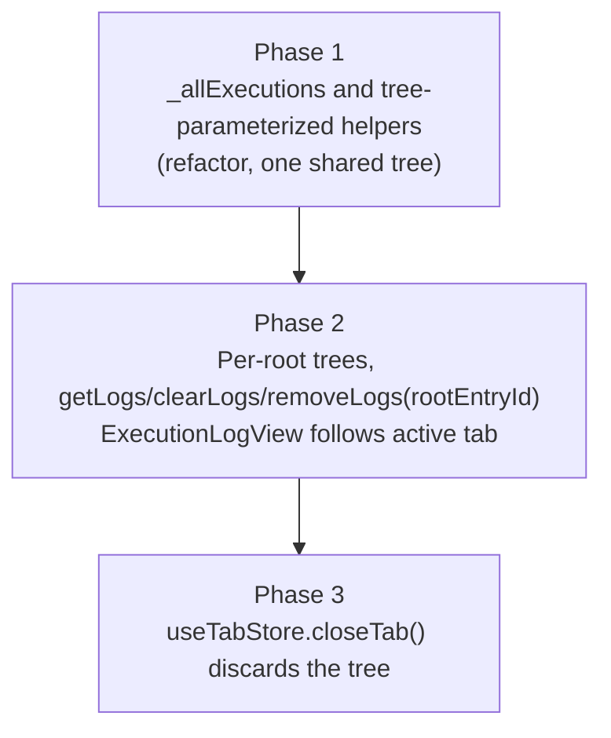

# Execution Log per Tab — Implementation Plan

> Design document: [doc/design/completed/execution-log-per-tab.md](../completed/execution-log-per-tab.md)
> Created 2026-11-18. The design document is final. This plan does not revisit its decisions.
> "Design: <section>" below points to a section of the design document's Design Considerations.

## Scope

All Functional Requirements (FR-1 to FR-8) and the resolved Design Considerations of the design document:

- `ExecutionLogService` keeps one execution tree per root entry in a reactive map `rootEntryId → { rootExecutions, executionsByParent }`, with a `null` fallback tree (FR-1, Design: "Data structure in `ExecutionLogService`").
- `addLog()` resolves the owning root itself: top-level records via `entryManager.getRootOf(entryId)`, child records from the parent's `rootEntryId` in `_allExecutions`; records with no root go into the `null` tree (FR-2, Design: "Where the root is resolved…").
- A flat, non-reactive `Map` `_allExecutions` (`executionId → shallowReactive execution`) used by `updateLog()` and for the child-root lookup. `_findExecution()` is removed (FR-3, Design: "How `updateLog()` finds the right tree").
- Service API `getLogs(rootEntryId)`, `clearLogs(rootEntryId)`, new `removeLogs(rootEntryId)`. `addLog()` / `updateLog()` keep their signatures (Design: "Service API shape").
- Per-tree record cap: `_getExecutionCount()`, `_cleanupExecutions()` and `_removeExecution()` take the tree as a parameter, and removed records also leave `_allExecutions` (FR-8, Design: "How the cap removes records").
- `ExecutionLogView` shows and clears only the active tab's tree, and hides only the active tab's root-container row (FR-4, FR-5).
- `useTabStore.closeTab()` calls `executionLogService.removeLogs(rootId)` (FR-6, Design: "Who discards the tree when a tab is closed").
- Tolerance of runs whose tree or records were removed mid-run (Design: "Executions still running when the tab changes or closes").
- Tests listed in Design: "Effect on existing tests" (AC-9).

FR-7 (`showLog` / `toggleLog()` stays global) needs no code change. It is covered by a test only.

## Out of scope

Taken from the design document's "Out of Scope". This plan does not implement:

- An "All tabs" view, a tab column, or a tab filter in the log view.
- Keeping or showing logs of closed tabs.
- Remembering the log panel's open/closed state per tab.
- Saving logs to disk or exporting them.
- Changing which columns the log table shows or how it formats them.
- Clearing logs as part of `RecipeItem.vue` `clearRecipe()`. It keeps not touching the log.

Also not done (rejected options in the design document): passing `rootEntryId` from `EntryExecutionService` (Design: "Where the root is resolved", option B), blocking `closeTab()` / `Clear` while executing (Design: "Executions still running", option C), and a Playwright e2e test (Design: "Effect on existing tests", option C).

## Current code check

The design document's Background matches the current code. Additional facts that affect the plan:

- `client/services/log/ExecutionLogService.js`: the tree is a `ref` (`_executionsTree`), `getLogs()` returns `readonly(this._executionsTree)` (a readonly **ref**; the view reads `logs.value`). `clearLogs()` replaces `_executionsTree.value`. `updateLog()` uses `_findExecution()`. All public methods catch errors and `console.error` them.
- `ExecutionLogService.addLog(entryId, inputParams, executionId, parentExecutionId)` — note the argument order. `EntryExecutionService.executeEntry(entryId, traceId)` calls `addLog(entryId, inputParams, executionId, traceId)`; for children, `_executeContainer()` passes the container's `executionId` as `traceId`. So `parentExecutionId` is always the direct parent's execution ID, and the parent's `addLog()` always runs before its children's.
- `EntryHierarchyHandler.getRootOf(entryId)` (via `EntryHandlerFacade.getRootOf()`) returns the root itself when called with a root ID, and `null` when the top of the parent chain is not a registered root (including unknown / removed entry IDs). It never throws for unknown IDs.
- Runs start through `EntryExecutionService.executeEntry(props.entryId)` in `RecipeItem.vue`, `BlockItem.vue` and `ContainerItem.vue`. None of them needs a change.
- `ExecutionLogView.vue` `transformedLogs` hides root rows by `new Set(tabStore.tabs.map(tab => tab.rootEntryId))`. It is mounted once in `MainArea.vue` inside `
`, so it is not re-mounted on tab switch.
- `client/services/log/__tests__/` does not exist. `ExecutionLogService` has no tests.
- `client/components/__tests__/ExecutionLogView.test.js` has one `describe('ExecutionLogView root rows')` test that stubs `getLogs()` with a `ref`.
- Besides `useTabStore.test.js` and `useTabStore.recipe.test.js`, three component tests create a real `useTabStore` and reach `closeTab()`: `MainArea.test.js` (`mountMainArea()`, close-button tests), `RecipeItem.test.js` (`does not throw when unmounted after its tab has been removed`) and `MenuArea.test.js` (restore failure → `openRecipeInNewTab()` → `closeTab()`). None of them provides `executionLogService` today. `MainArea.test.js` stubs `ExecutionLogView`.
- `MainArea.vue` sets `pointer-events: none` on `.main-content.executing`. The service must not rely on it (Design: "Executions still running").

## Phase overview

Phase 1 is a behavior-preserving refactor of the service. Phase 2 adds the per-root trees and switches the view in the same commit (the view's `getLogs()` call must change together with the API). Phase 3 wires `closeTab()`.

---

## [Resolved] Phase 1: Flat execution dictionary and tree-parameterized helpers (refactor)

**Goal:** Prepare `ExecutionLogService` for several trees without changing behavior. There is still one shared tree, and the public API is unchanged.

**Files to change:**

- `client/services/log/ExecutionLogService.js`
  - Add `this._allExecutions = new Map()` (plain, not reactive) in the constructor.
  - `addLog()`: wrap the new record with `shallowReactive(execution)`, register the proxy in `_allExecutions`, and push the **same proxy** into the tree.
  - `updateLog()`: get the record with `this._allExecutions.get(executionId)`. Do nothing when it is missing. Replace only top-level fields (`result`, `execTime`) as today.
  - Change `_getExecutionCount()`, `_cleanupExecutions(count)` and `_removeExecution(executionId)` to `_getExecutionCount(tree)`, `_cleanupExecutions(tree, count)` and `_removeExecution(tree, executionId)`. `addLog()` passes `this._executionsTree.value`.
  - `_removeExecution(tree, executionId)` also deletes the execution itself and every descendant from `_allExecutions`. Because `_cleanupExecutions()` calls it for each removed top-level execution, this covers the cap path.
  - `clearLogs()`: also clear `_allExecutions`.
  - Remove `_findExecution()`.
  - Update JSDoc. Add a comment at the `shallowReactive` call that `updateLog()` must only replace top-level fields; if nested mutation is ever added, switch to `reactive()` (Design: "How `updateLog()` finds the right tree").

**Behavior that must not change:**

- `getLogs()` still returns a readonly ref to the one shared tree. `ExecutionLogView` is not touched and renders the same.
- The 1000-record cap and 100-record batch cleanup over the whole (single) tree.
- `updateLog()` for an unknown execution ID still does nothing and does not throw.
- The `ExecutionLogView` updates when `updateLog()` sets `result` / `execTime` (this is why the proxy, not the raw object, is stored).

**Tests to add:**

- New `client/services/log/__tests__/ExecutionLogService.test.js`, written against the current single-tree API. These tests are rewritten in Phase 2.
  - `describe('ExecutionLogService.updateLog')`: updates `result` and `execTime` of a top-level and a child record; an update made after `getLogs()` was read is visible through it (reactivity, e.g. with a `computed` or `watch`); unknown ID does nothing and does not throw.
  - `describe('ExecutionLogService cap')`: after 1001 top-level records, the oldest 100 are removed, and their IDs are no longer in `_allExecutions`; removing a container also removes its descendants from the tree and from `_allExecutions`.
  - `describe('ExecutionLogService.clearLogs')`: the tree and `_allExecutions` are empty after `clearLogs()`.

**Completion criteria:**

- `npm test` passes (including the unchanged `ExecutionLogView.test.js`).
- `npm run electron:start`: run a recipe, a single block and a single container. The log shows the same rows, status and execution times as before.

---

## [Open] Phase 2: Per-root execution trees and active-tab log view

**Goal:** FR-1 to FR-5, FR-7, FR-8: one tree per root entry, root resolved in `addLog()`, per-tree cap, and a view that shows and clears only the active tab's tree.

**Files to change:**

- `client/services/log/ExecutionLogService.js`
  - Replace `_executionsTree` with a reactive map of trees, e.g. `this._trees = reactive(new Map())` (`Map` so that the `null` key is a real key; see Notes for reviewer N4). A tree is `{ rootExecutions: [], executionsByParent: {} }`. A private helper `_getOrCreateTree(rootEntryId)` creates it on first use.
  - `addLog(entryId, inputParams, executionId, parentExecutionId = null)` (signature unchanged):
    - If `parentExecutionId` is set: `rootEntryId = this._allExecutions.get(parentExecutionId)?.rootEntryId ?? null`. `getRootOf()` is not called. A parent missing from `_allExecutions` (removed by cap, `clearLogs()` or `removeLogs()`) gives `null`.
    - Otherwise: `rootEntryId = this.entryManager?.getRootOf(entryId) ?? null`.
    - Store `rootEntryId` on the execution object. File the proxy into `_getOrCreateTree(rootEntryId)` (into `executionsByParent[parentExecutionId]` or `rootExecutions` as today) and register it in `_allExecutions`.
    - Count **that tree only** with `_getExecutionCount(tree)`; if it is over `_maxLogs`, call `_cleanupExecutions(tree, _cleanupBatchSize)`.
  - `updateLog(executionId, result)`: unchanged from Phase 1 (lookup through `_allExecutions`; never recreates a tree).
  - `getLogs(rootEntryId)`: if `rootEntryId` is `null`/`undefined`, or no tree exists for it, return a readonly empty tree. Otherwise return `readonly(tree)` from the reactive map. The lookup must go through the reactive map so that a `computed` calling `getLogs(id)` re-runs when that root's tree is created, replaced or deleted.
  - `clearLogs(rootEntryId)`: delete every record of that tree from `_allExecutions`, then empty the tree. Other trees and their `_allExecutions` entries are untouched. For `null`/`undefined` see Notes for reviewer N1.
  - New `removeLogs(rootEntryId)`: delete every record of that tree from `_allExecutions`, then delete the tree and its key. Unknown root: no-op.
  - Keep the existing try/catch + `console.error` style in public methods.
- `client/components/ExecutionLogView.vue`
  - `const logs = computed(() => executionLogService.getLogs(tabStore.activeTab?.rootEntryId))`. `transformedLogs` reads `logs.value` (now the tree object itself, not a ref).
  - Root-row rule: hide a top-level row (and its container-end row) only when `execution.entryId === tabStore.activeTab?.rootEntryId`; its children are still listed. Remove the `rootEntryIds` set over all tabs.
  - `clearLogs()` calls `executionLogService.clearLogs(tabStore.activeTab?.rootEntryId)`.
  - Template, columns, formatting and styles are unchanged.

**Behavior that must not change:**

- `addLog()` / `updateLog()` signatures; `EntryExecutionService`, `RecipeItem.vue`, `BlockItem.vue`, `ContainerItem.vue` and `client/main.js` are not changed.
- Display rules: newest top-level execution first, sandwich-style container rows with `container-end` footer rows, the active tab's root-container row hidden while its children are listed, empty panel when there are no rows.
- `showLog` / `toggleLog()` in `useSystemState.js` and the `v-show` in `MainArea.vue` (FR-7).
- `RecipeItem.vue` `clearRecipe()` does not touch the log.
- Cap values (`_maxLogs = 1000`, `_cleanupBatchSize = 100`) and "only whole top-level executions are removed, one batch per `addLog()`".

**Tests to add / update:**

- `client/services/log/__tests__/ExecutionLogService.test.js` (rewrite the Phase 1 tests for the per-root API). Use a real `EntryHandlerFacade` and create roots the way `useTabStore.createTab()` does (`addEntry('container', 'root-container')`, `moveEntry(rootId, null, 0)`).
  - `describe('ExecutionLogService per-root trees')` (AC-1): records of a recipe run in root A and root B land in two trees; `getLogs(A)` contains no record of B and vice versa; each record has the right `rootEntryId`.
  - `describe('ExecutionLogService root resolution')` (AC-2): a top-level record for a block / container nested inside root B goes into B's tree; child records (with `parentExecutionId`) go into the parent's tree without calling `getRootOf()` (spy); with no `entryManager`, or when `getRootOf()` returns `null`, the record goes into the `null` tree; `getLogs(null)` and `getLogs(undefined)` return an empty tree even when the `null` tree has records.
  - `describe('ExecutionLogService.updateLog')` (AC-3): result and execution time appear on the record in the correct root's tree, through `getLogs()` reactively; unknown ID does nothing.
  - `describe('ExecutionLogService.clearLogs')` (AC-5): `clearLogs(A)` empties A's tree and removes A's records from `_allExecutions`; B's tree and B's `_allExecutions` entries are unchanged.
  - `describe('ExecutionLogService.removeLogs')` (AC-6): after `removeLogs(A)` the key A is gone from the map, A's records are gone from `_allExecutions`, B is unchanged; `removeLogs()` of an unknown root does nothing.
  - `describe('ExecutionLogService per-tree cap')` (AC-8): when A goes over 1000 records, the oldest 100 top-level executions of A and their descendants are removed from A and from `_allExecutions`, and B is unchanged; the `null` tree is capped the same way; a tree whose only top-level execution has more than 1000 records stays above the cap.
  - `describe('ExecutionLogService executions still running')` (the three required tests in Design: "Executions still running"): `updateLog()` after `removeLogs(A)` does nothing, does not throw, and does not recreate A; `updateLog()` after `clearLogs(A)` does nothing and A stays empty; a child record added after its parent was removed by the cap goes into the `null` tree and `getLogs(A)` does not show it.
  - `describe('ExecutionLogService reactivity')`: a `computed(() => service.getLogs(A))` updates when A's first record is added, when A is cleared, and when A is removed.
- `client/components/__tests__/ExecutionLogView.test.js` (rewrite). Use a real `ExecutionLogService` with the test's `EntryHandlerFacade` and a real `useTabStore`, so the view is tested against the real per-root API.
  - `describe('ExecutionLogView active tab')` (AC-4): with tab 1 active only tab 1's rows are listed; after `setActiveTab(t2)` only tab 2's rows; with no tabs open the empty panel is shown; the active tab's root-container row and its footer are hidden and its children are listed newest first, with sandwich rows for nested containers; a single block run in a tab is shown as a top-level row.
  - `describe('ExecutionLogView Clear')` (AC-5): clicking `Clear` with tab 1 active empties the view; after switching to tab 2 its rows are still listed.
  - `describe('ExecutionLogView panel visibility')` (AC-7): see Notes for reviewer N3 for where this test mounts the panel.
- `client/stores/__tests__/useTabStore.test.js`, `useTabStore.recipe.test.js`, `client/components/__tests__/MainArea.test.js`, `RecipeItem.test.js`, `MenuArea.test.js`: no change in this phase (the store does not inject the service yet).

**Completion criteria:**

- `npm test` passes.
- `npm run electron:start`, manual checks:
  - Open two tabs, run each recipe: each tab's log shows only its own runs; switching tabs switches the log (AC-1, AC-4).
  - Run a single block and a single container in tab 2: rows appear in tab 2's log only (AC-2), with status and execution time (AC-3).
  - `Clear` in tab 1, switch to tab 2: tab 2's log is unchanged (AC-5).
  - With the log panel open, switch tabs: it stays open; toggle it closed and switch tabs: it stays closed (AC-7).
  - Close all tabs with the panel open: the log is empty.

---

## [Open] Phase 3: Discard a tab's log tree in `closeTab()`

**Goal:** FR-6: closing a tab removes its root's tree from `ExecutionLogService`.

**Files to change:**

- `client/stores/useTabStore.js`
  - `const executionLogService = inject('executionLogService')` next to the other `inject()` calls.
  - In `closeTab()`, in the synchronous part after the `deleteComm()` / `shutdownRunner()` awaits and after the `index === -1` check, call `executionLogService.removeLogs(rootId)` next to `entryManager.removeEntry(rootId)`, before `tabs.value.splice(index, 1)`. No `await` is added.
  - Update the doc comment of `closeTab()` to mention the log tree.
- Test setup only (provide a stub `executionLogService = { removeLogs: vi.fn() }`, because `inject()` returns `undefined` otherwise and `closeTab()` would throw):
  - `client/stores/__tests__/useTabStore.test.js` (`beforeEach`)
  - `client/stores/__tests__/useTabStore.recipe.test.js` (`beforeEach`)
  - `client/components/__tests__/MainArea.test.js` (`mountMainArea()`)
  - `client/components/__tests__/RecipeItem.test.js` (the Pinia/app setup used by `setup()` / `createTestPinia()`)
  - `client/components/__tests__/MenuArea.test.js` (app setup)
  - `client/components/__tests__/ExecutionLogView.test.js` already provides a real service from Phase 2; check that it is also provided to the store's app.
  - The last four files are not listed in the design document; see Notes for reviewer N2.

**Behavior that must not change:**

- The order `deleteComm` → `shutdownRunner` → `removeEntry`, and a closed tab is still removed even if they throw.
- Closing an unknown tab ID does nothing (no `removeLogs()` call).
- Other tabs' trees are untouched.
- `openRecipeInNewTab()` is not changed; its restore-failure path reaches `removeLogs()` through `closeTab()`.

**Tests to add / update:**

- `client/stores/__tests__/useTabStore.test.js`, `describe('useTabStore.closeTab')`:
  - Extend `calls deleteComm, shutdownRunner, then removeEntry with the same rootId` (or add a test) so that `removeLogs(rootId)` is called once with the closed tab's `rootEntryId`, after `shutdownRunner` (AC-6).
  - `removeLogs` is still called when `deleteComm` / `shutdownRunner` throw.
  - `removeLogs` is not called for an unknown tab ID.
  - With a real `ExecutionLogService`: after closing tab 1, its tree no longer exists and tab 2's tree is unchanged (AC-6).
- `client/stores/__tests__/useTabStore.recipe.test.js`, `describe('useTabStore.openRecipeInNewTab')`: when restoring fails, `removeLogs` is called with the created tab's `rootEntryId`.

**Completion criteria:**

- `npm test` passes.
- `npm run electron:start`: run recipes in two tabs, close tab 1: tab 2's log is unchanged. Open a new tab: its log is empty.

---

## Acceptance Criteria

| # | Criterion (from the design document) | FR | Phase | Covered by |
|---|---|---|---|---|
| AC-1 | Recipe runs in tab 1 and tab 2 go into two separate trees keyed by their `rootEntryId`s. | FR-1, FR-2 | 2 | `ExecutionLogService.test.js` `ExecutionLogService per-root trees` |
| AC-2 | A single block / container run in tab 2, with its child records, goes into tab 2's tree. | FR-2 | 2 | `ExecutionLogService.test.js` `ExecutionLogService root resolution`; `ExecutionLogView.test.js` `ExecutionLogView active tab` |
| AC-3 | Result and execution time appear on the record in the correct tab's tree. | FR-3 | 1, 2 | `ExecutionLogService.test.js` `ExecutionLogService.updateLog` |
| AC-4 | The view lists only the active tab's executions, follows tab switches, is empty with no tabs, and hides the active tab's root-container row. | FR-4 | 2 | `ExecutionLogView.test.js` `ExecutionLogView active tab` |
| AC-5 | `Clear` in tab 1 empties tab 1 only. | FR-5 | 2 | `ExecutionLogService.test.js` `ExecutionLogService.clearLogs`; `ExecutionLogView.test.js` `ExecutionLogView Clear` |
| AC-6 | After closing a tab, its tree is gone and other trees are unchanged. | FR-6 | 2, 3 | `ExecutionLogService.test.js` `ExecutionLogService.removeLogs`; `useTabStore.test.js` `useTabStore.closeTab` |
| AC-7 | The panel stays open across tab switches and shows the new tab's log; closing it hides it for every tab. | FR-7 | 2 | `ExecutionLogView.test.js` `ExecutionLogView panel visibility` (see N3) |
| AC-8 | Per-tree cap: oldest top-level executions of that tree only are removed, also from `_allExecutions`; a tree may stay above 1000 when one execution alone is larger. | FR-8 | 1, 2 | `ExecutionLogService.test.js` `ExecutionLogService per-tree cap`, `ExecutionLogService executions still running` |
| AC-9 | The listed test files are rewritten / added / extended and `npm test` passes. | all | 1–3 | Completion criteria of every phase |

## Notes for reviewer

- **N1: `clearLogs()` with no active tab.** The design document defines `getLogs(null/undefined)` as an empty tree, but not what `clearLogs(null)` / `clearLogs(undefined)` do. With no tab open, `ExecutionLogView` would call `clearLogs(undefined)`. If this clears the hidden `null` fallback tree, `Clear` deletes records the user cannot see (the reason given in Design: "Scope of the Clear button" argues against that); if it does nothing, the `null` tree is only ever trimmed by its cap. The same question applies to `removeLogs(null)`. Please decide. Until then, no test pins this behavior.
- **N2: More test files need the `executionLogService` stub.** The design document names only `useTabStore.test.js` and `useTabStore.recipe.test.js`. `MainArea.test.js`, `RecipeItem.test.js` and `MenuArea.test.js` also create a real `useTabStore` and reach `closeTab()`, so they fail once `closeTab()` calls `removeLogs()` on an undefined service. Phase 3 adds the stub to them as a test-setup change only (no new assertions). The alternative, making `closeTab()` tolerate a missing service (`executionLogService?.removeLogs(...)`), was not chosen because the design document says the store tests "must provide a stub". Please confirm.
- **N3: Where the AC-7 test lives.** The design document puts the AC-7 test ("panel stays open across tab switches") in `ExecutionLogView.test.js`, but the panel visibility (`v-show="showLog"`) is in `MainArea.vue`, not in `ExecutionLogView.vue`. The plan keeps the test in `ExecutionLogView.test.js` and mounts `MainArea` there with the real `ExecutionLogView` (and `RecipeItem` stubbed), checking that `.log-popup` stays visible and shows the new tab's rows after `setActiveTab()`, and is hidden for every tab after `toggleLog()`. If the reviewer prefers, this test can move to `MainArea.test.js` instead.
- **N4: Type of the reactive map.** The design document says "for example a reactive map". The plan uses `reactive(new Map())` because the `null` fallback key must not collide with a string key (a plain object would turn `null` into the string `"null"`). This is an implementation choice, not a design change.
- **N5: `clearLogs(rootEntryId)` for a root with no tree yet.** The plan treats it as a no-op that does not create a tree. The design document does not say whether "empties that root's tree" should create an empty tree in this case. The view's output is the same either way.
