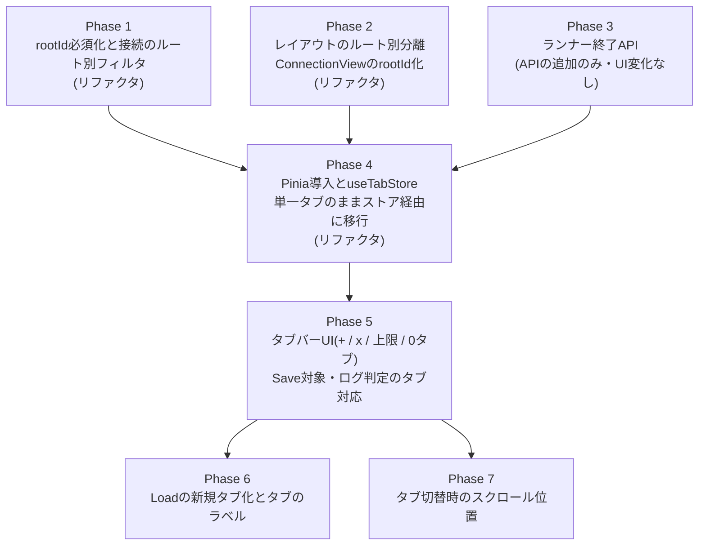

# Multi-Tab Support for MainArea 実装計画

> 対象設計書: [doc/design/main-area-multi-tab.md](../design/main-area-multi-tab.md)
> 作成日 2026-10-30。設計書の決定事項は確定済みとして扱い、本計画では再検討しない。
> 本文中の「設計書 セクションN」は上記設計書の Design Considerations の節番号を指す。

## Scope

設計書の Functional Requirements と Design Considerations セクション1〜7の決定事項のうち、以下を実装する。

- ルートエントリ/レシピ操作APIのrootId必須化(`EntryHandlerFacade.clearEntries(rootId)`、`RecipeSerializer.buildRecipe(rootId)`、`RecipeDeserializer.restoreRecipe(data, rootId)`、`EntryPersistanceService`・`useEntryOperation`の対応)と接続のルート別フィルタ(設計書 セクション1)
- Piniaの導入と`client/stores/useTabStore.js`の新設(設計書 セクション2)
- レイアウトストアのルート別分離、`ConnectionView`のrootId化、`commBtnStatus`のストア移管、`visibleTabs`によるRecipeItemの描画(設計書 セクション3)
- タブ切替時の`resetState()`、`ExecutionLogView`のルート行除外判定の全タブ対応(設計書 セクション4)
- ルート単位のランナー終了API(Electron `runner:shutdown`、Web版 `DELETE /api/runners/:entryId`、`ScriptExecutionService.shutdownRunner()`、`EntryExecutionService.shutdownRunner()`)と`useTabStore.closeTab()`の削除順序(設計書 セクション5、セクション7の残課題)
- タブバーUI(タブ一覧、各タブのxボタン、+ボタン、上限10個での+ボタン無効化、0タブ時の空状態)、xボタンの確認ダイアログ、タブのラベル規則、新規タブの即時アクティブ化、Loadのファイル選択確定後のタブ作成と失敗時の後始末、タブ切替時のスクロール位置の保存・復元(設計書 セクション6)

## Out of scope

設計書でスコープ外とされた事項。本計画では実装しない。

- 画面分割表示(複数タブの同時表示)。`panes`/`focusedPaneId`の追加、ペイン間のドラッグ&ドロップ、ルートを跨ぐパラメータ接続の拒否、同一タブの複数ペイン表示時のスクロール位置(設計書 セクション3「分割表示を実装する際に別途検討する事項」)。今回は`visibleTabs = activeTab ? [activeTab] : []`の構造だけを用意する。
- タブ単位の実行ロック、実行ログのタブ別フィルタ、実行中タブの削除処理。`isExecuting`・`selectedEntryId`・`connectingSource`・`lastError`・`ExecutionLogService`の実行履歴はアプリ全体で1つのまま(設計書 セクション4)。
- タブ作成時のソケット作成(設計書 セクション6「通信ソケットを新規に作成」の意味。ソケットは`CommSettingView`で`useTcpIp`を有効にした時点で作成する既存動作のまま)。
- 未保存変更(dirtyフラグ)に基づくタブ削除確認(設計書 セクション6「タブ削除時の確認ダイアログ」で(D)不採用)。
- レシピの`meta.name`をタブラベルに使うこと(設計書 セクション6「タブのラベル」で(A)不採用)。
- スクロール位置のECS・レシピファイルへの保存、アプリ再起動後の復元(設計書 セクション6「タブ切替時のスクロール位置」)。
- `RunnerHostRegistry`のアイドルタイムアウト、ソケット破棄に連動したランナー終了(設計書 セクション5で(B)(C)不採用)。
- 新規タブ初回実行時のimportコスト(設計書 セクション7「注意点」。要検討事項として残るのみ)。

## 現状コードの確認結果

設計書の Background の記述は現在のコードと一致していることを確認した。計画に影響する補足事項は以下のとおり。

- `client/components/MainArea.vue` `setup()`でルートを1つ生成し、静的な`.tab-bar`(ラベル"Recipe")と単一の`RecipeItem`を描画している。
- `client/components/RecipeItem.vue` `clearRecipe()`は`entryManager.clearEntries()`を引数なしで呼び、`measureEntries()`は`entryManager.clearLayouts()`(全エントリ)を呼ぶ。`entryLayoutMap`は`entryManager.layoutsTick`と`getAllLayouts()`を参照する。`commBtnStatus`はローカル`ref`。
- `client/components/ConnectionView.vue` `connectionsWithLanes`は`getConnections()`(全ルート)と`layoutsTick`を参照し、propを持たない。
- `client/components/MenuArea.vue` `onSaveRecipe()`は`saveRecipe()`を引数なしで呼ぶ(そのため`EntryPersistanceService.saveRecipe()`の提案名は既定の`recipe`になる)。`onLoadRecipe()`は`entryManager.getRoot()`で上書き確認を行う。Load/Saveボタンは`isExecuting`のみで無効化される。
- `client/components/ExecutionLogView.vue` `transformedLogs`は`entryManager.getRoot()`と比較している。
- `getRoot()`のアプリコードでの呼び出しは`RecipeSerializer.buildRecipe()`・`RecipeDeserializer.restoreRecipe()`・`MenuArea.vue` `onLoadRecipe()`・`ExecutionLogView.vue` `transformedLogs`の4箇所のみ。
- `getConnections()`のアプリコードでの呼び出しは`ConnectionView.vue`・`RecipeSerializer.buildRecipe()`・`RecipeDeserializer.restoreRecipe()`の3箇所のみ。
- `World.despawn()`は`layouts`コンポーネントも削除するため、`removeEntry()`/`clearEntries()`で削除されたエントリのレイアウトは既に消える(`EntryPersistanceService.test.js`の`clears stale entries, params and layout before restoring, even into a smaller recipe`で検証済み)。
- `RunnerHostRegistry.shutdown(entryId)`は実装済みで、未登録時は`Promise.resolve()`を返す。`RunnerHostRegistry`と`server/api.js`のユニットテストは現在存在しない。
- `useEntryOperation.saveRecipe()`/`loadRecipe()`、`useTabStore`、`MainArea`/`MenuArea`/`RecipeItem`/`ConnectionView`/`ExecutionLogView`のユニットテストは現在存在しない。
- `package-lock.json`上のVueは3.5.34(`package.json`の範囲指定は`^3.2.13`)。Piniaは未導入。
- Vitestの環境は`jsdom`(`vitest.config.js`)。サーバ側テストはファイル先頭に`// @vitest-environment node`を付けて実行する。

## フェーズ構成

振る舞いを変えないリファクタリング(Phase 1〜4)を先に行い、その後に新機能(Phase 5〜7)を追加する。各フェーズは単独で実装・テスト・コミットできる。

Phase 1〜3は互いに独立しており順不同で実施できる。Phase 6とPhase 7も互いに独立している。

---

### [Resolved] Phase 1: ルート操作APIのrootId必須化と接続のルート別フィルタ

**目的:** 設計書 セクション1のAPI変更のうち、タブストアに依存しない部分を行う。タブは1つのままで、アプリの振る舞いは変えない。

**変更するファイルと内容:**

- `client/ecs/component-handlers/EntryHandlerFacade.js`
  - `clearEntries()` → `clearEntries(rootId)`。`isRoot(rootId)`が偽(未指定を含む)なら例外を投げる。内部の`hierarchyHandler.getRoot()`呼び出しを削除する。
  - `getConnections()` → `getConnections(rootId)`。両端が`getRootOf(endpoint.entryId) === rootId`を満たす接続のみを返す(設計書 セクション1「接続のルート別フィルタ」、セクション3 変更3)。rootIdの扱い(必須かどうか)は「Notes for reviewer」1を参照。
  - `getRoot()`は変更しない(JSDocに「アプリコードからは呼ばない」旨を追記する)。
  - `EntryConnectionHandler.getConnections()`(内部ハンドラ)は全件を返すまま変更しない。
- `client/services/entry_persistance/RecipeSerializer.js`
  - `buildRecipe()` → `buildRecipe(rootId)`。`isRoot(rootId)`で検証し、偽なら例外。`connections`は`entryManager.getConnections(rootId)`を使う。`getRoot()`呼び出しを削除する。
- `client/services/entry_persistance/RecipeDeserializer.js`
  - `restoreRecipe(data)` → `restoreRecipe(data, rootId)`。`isRoot(rootId)`で検証し、偽なら例外(`_migrate()`の検証と同様、ECSを変更する前に投げる)。内部の`clearEntries(rootId)`・`entryExecutionService.deleteComm(rootId)`に同じrootIdを渡す。`connectionCount`は`getConnections(rootId).length`とする。`getRoot()`呼び出しを削除する。
- `client/services/entry_persistance/EntryPersistanceService.js`
  - `buildRecipe()` → `buildRecipe(rootId)`、`restoreRecipe(data)` → `restoreRecipe(data, rootId)`、`saveRecipe(name)` → `saveRecipe(rootId, name)`。
  - `loadRecipe()`はこのフェーズでは暫定的に`loadRecipe(rootId)`とし、ファイル選択後に`restoreRecipe(picked.data, rootId)`を呼ぶ。Phase 6で`pickRecipe()`に置き換えて廃止する。
- `client/composables/useEntryOperation.js`
  - `saveRecipe(name)` → `saveRecipe(rootId)`。`entryPersistanceService.saveRecipe(rootId)`を呼ぶ(提案名は従来どおり既定の`recipe`。タブラベルの利用はPhase 6)。
  - `loadRecipe()` → 暫定的に`loadRecipe(rootId)`。`entryPersistanceService.loadRecipe(rootId)`を呼ぶ。`resetState()`はこのフェーズでは残す。
- `client/components/RecipeItem.vue` `clearRecipe()`: `entryManager.clearEntries(props.entryId)`とする(最終形)。
- `client/components/MenuArea.vue`: 暫定的に、既存の`entryManager.getRoot()`の値を`saveRecipe(rootId)`・`loadRecipe(rootId)`に渡す(このフェーズでは`getRoot()`呼び出しは`onLoadRecipe()`の既存箇所から`onSaveRecipe()`にも広がる。Phase 5で`useTabStore`経由に置き換えて削除する)。

**変えてはならない振る舞い:**

- 単一タブでのClear・Save・Loadの結果(保存されるJSONの内容、Load時の上書き確認、Load後のエントリ・接続・通信設定の復元)。
- Save時のダイアログの提案名(`recipe.json`)。
- `restoreRecipe()`が不正な`formatVersion`で例外を投げた場合に現在のレシピが変更されないこと。

**追加・更新するテスト:**

- `client/ecs/component-handlers/__tests__/EntryHandlerFacade.test.js`
  - 新規 `describe('EntryHandlerFacade.clearEntries')`: 指定ルートの子孫のみ削除され他ルートの子孫・接続が残ること、ルート自身は残ること、未指定・非ルートIDで例外を投げること。
  - 新規 `describe('EntryHandlerFacade.getConnections')`: 2ルートにそれぞれ接続を作り、`getConnections(rootA)`がrootAの接続のみを返すこと。
- `client/services/entry_persistance/__tests__/EntryPersistanceService.test.js`
  - 既存 `describe('EntryPersistanceService round trip')`の各テスト: `buildRecipe()`/`restoreRecipe(recipe)`/`saveRecipe()`/`loadRecipe()`の呼び出しを`ctx.rootId`を渡す形に更新する。`getConnections()`の呼び出しも同様に更新する。
  - 新規 `describe('EntryPersistanceService multiple roots')`: 2ルートを作成し、(1) `buildRecipe(rootA)`がrootAのエントリと接続だけを含むこと、(2) `restoreRecipe(data, rootA)`がrootAだけをクリア・復元し、rootBのエントリと接続が影響を受けないこと、`connectionCount`がrootA分のみであること、(3) `restoreRecipe(data, rootA)`がrootBのソケット記録を削除しないこと(`deleteComm`がrootAでのみ呼ばれること)、(4) rootId未指定・非ルートIDで`buildRecipe`/`restoreRecipe`が例外を投げ、ECSが変更されないこと。

**完了条件:**

- `npm test`が通る。
- `npm run lint`が通る。
- `npm run electron:start`で、ブロック追加 → Save → Clear → Load の一連が従来どおり動作すること、Clearボタンでレシピが空になることを確認する。

---

### [Open] Phase 2: レイアウトストアのルート別分離とConnectionViewのrootId化

**目的:** 設計書 セクション3「今回の実装で行う変更」1〜3を行い、RecipeItem以下を「自分のrootIdの範囲だけを扱う」実装に揃える。タブは1つのままで、表示は変えない。

**変更するファイルと内容:**

- `client/ecs/components/EntryLayoutComponent.ts`: `rootId: string`を追加する。
- `client/ecs/component-handlers/EntryHandlerFacade.js`
  - 単一の`_layoutsTick`と`layoutsTick` getterを廃止し、ルート別のtickを保持する`Map`(`_layoutsTicks`)を追加する。ルート登録時(`moveEntry(entryId, null, …)`で`setRoot()`する箇所)にtickを作成し、`removeEntry()`でルート自身を削除する分岐(`unsetRoot()`を呼ぶ箇所)でtickを破棄する(設計書 セクション3 変更1。`EntryHierarchyHandler`の`_hierarchyTicks`と同じ作り)。
  - 新規 `getLayoutsTick(rootId)`: ルートのtickを返す(未登録なら`undefined`。`getHierarchyTick()`と同じ)。
  - `addLayout(entryId, y, height)`: `getRootOf(entryId)`を記録し、そのルートのtickを進める。ルートが解決できない場合の扱いは「Notes for reviewer」3を参照。
  - `clearLayouts()` → `clearLayouts(rootId)`: `rootId`が一致するレイアウトのみ削除し、そのルートのtickを進める。`getAllLayouts()` → `getAllLayouts(rootId)`: 一致するもののみ返す。いずれも`isRoot(rootId)`で検証し、偽なら例外(設計書 セクション3 変更1「セクション1と同じ方針でrootIdは必須」)。
  - `getLayout(entryId)`は変更しない。
- `client/components/RecipeItem.vue`
  - `measureEntries()`: `entryManager.clearLayouts(props.entryId)`を呼ぶ。
  - `entryLayoutMap`: `entryManager.getLayoutsTick(props.entryId)?.value`と`getAllLayouts(props.entryId)`を参照する。
  - テンプレートで`<ConnectionView :root-id="entryId" />`を渡す。
- `client/components/ConnectionView.vue`
  - prop `rootId`(`{ type: String, required: true }`)を追加する。
  - `connectionsWithLanes`: `entryManager.getLayoutsTick(props.rootId)?.value`を参照し、`entryManager.getConnections(props.rootId)`を描画対象にする。

実装上の注意: ルート削除(Phase 4の`closeTab()`)ではtickが破棄された後にRecipeItemがアンマウントされる。そのため`getLayoutsTick()`/`getHierarchyTick()`の戻り値は`?.value`で参照し、`undefined`でも例外にならないようにする(既存の`watch(() => entryManager.getHierarchyTick(props.entryId).value, …)`も同様に`?.`を付ける)。

**変えてはならない振る舞い:**

- 単一タブでの背景線・接続線の描画位置、エントリの追加/移動/削除後の再計測。
- `getLayout(entryId)`の戻り値の形(`y`/`height`を参照する既存コードがそのまま動くこと。`rootId`フィールドが増えるだけ)。
- 削除されたエントリのレイアウトが残らないこと。

**追加・更新するテスト:**

- `client/ecs/component-handlers/__tests__/EntryHandlerFacade.test.js`
  - 新規 `describe('EntryHandlerFacade layouts')`: (1) 2ルートのエントリに`addLayout`し、`getAllLayouts(rootA)`がrootA分のみ返すこと、(2) `clearLayouts(rootA)`後もrootBのレイアウトが残ること、(3) `addLayout`/`clearLayouts`がそのルートの`getLayoutsTick`だけを進め、他ルートのtickが変わらないこと、(4) `removeEntry(rootA)`後に`getLayoutsTick(rootA)`が`undefined`になること、(5) `clearLayouts`/`getAllLayouts`がrootId未指定・非ルートIDで例外を投げること。
  - `client/services/entry_persistance/__tests__/EntryPersistanceService.test.js`の`clears stale entries, params and layout before restoring, even into a smaller recipe`が引き続き通ること(更新不要の見込み)。
- 新規 `client/components/__tests__/ConnectionView.test.js`
  - `describe('ConnectionView rootId filter')`: 実`EntryHandlerFacade`で2ルートに接続とレイアウトを用意し、`rootId: rootA`でマウントすると`ConnectionItem`がrootAの接続数だけ描画されること。
- 新規 `client/components/__tests__/RecipeItem.test.js`
  - `describe('RecipeItem layouts')`: `ConnectionView`に`root-id`として`entryId`が渡されること、`clearRecipe`(Clearボタン)が`clearEntries(entryId)`を呼ぶこと(Phase 1の変更の確認を兼ねる)。

**完了条件:**

- `npm test`・`npm run lint`が通る。
- `npm run electron:start`で、ブロック追加・コンテナのネスト・パラメータ接続を行い、背景線と接続線が従来どおりエントリのヘッダ位置に揃って描画されること、ドラッグで並べ替えた後も追従することを確認する。

---

### [Open] Phase 3: ルート単位のランナー終了API

**目的:** 設計書 セクション5「追加するAPI」を実装する。APIの追加のみで、このフェーズではUIからは呼ばない。

**変更するファイルと内容:**

- `electron/main.js`: `ipcMain.handle('runner:shutdown', async (_evt, entryId) => ensureRunnerRegistry().shutdown(entryId))`を既存の`socket:destroy`ハンドラの隣に追加する。`get()`は経由しない。
- `electron/preload.js`: `shutdownRunner: (entryId) => ipcRenderer.invoke('runner:shutdown', entryId)`を追加する。
- `server/api.js` `createApiRouter()`: `router.delete('/runners/:entryId', …)`を追加する。`await runnerRegistry.shutdown(req.params.entryId)`の後に`res.json({ shutdown: true })`を返す。`get()`は経由しない。失敗時の応答は「Notes for reviewer」5を参照。
- `client/services/script_execution/ScriptExecutionService.js`: `shutdownRunner(entryId)`を追加する。`createSocket()`/`destroySocket()`と同様に、Electron版は`window.electronAPI.shutdownRunner(entryId)`、Web版は`fetch('/api/runners/' + encodeURIComponent(entryId), { method: 'DELETE' })`を呼ぶ。
- `client/services/entry_execution/EntryExecutionService.js`: `shutdownRunner(entryId)`を追加し、`this.scriptExecutionService.shutdownRunner(entryId)`に委譲する。

**変えてはならない振る舞い:**

- 既存のIPC(`script:execute`/`socket:create`/`socket:destroy`)・HTTP API(`POST /api/scripts/:name/execute`/`POST /api/sockets`/`DELETE /api/sockets/:id`)の挙動。
- アプリ/サーバ終了時の`shutdownAll()`(`electron/main.js`の`before-quit`、`server/index.js`の`shutdown()`)。
- `RunnerHostRegistry`自体は変更しない。

**追加・更新するテスト:**

- 新規 `shared/__tests__/RunnerHostRegistry.test.js`(`// @vitest-environment node`)
  - `describe('RunnerHostRegistry.shutdown')`: モックの`createHostFn`(`shutdown`を持つオブジェクトを返す)で2つのentryIdのホストを`get()`し、(1) `shutdown(a)`がaのホストの`shutdown()`だけを呼び、bのホストは残ること(`get(b)`が同じインスタンスを返す)、(2) 未登録のentryIdで`createHostFn`も`shutdown()`も呼ばれず解決すること、(3) 同じentryIdへの2回目の呼び出しが無害であること。
- 新規 `server/__tests__/api.test.js`(`// @vitest-environment node`)
  - `describe('DELETE /api/runners/:entryId')`: `createApiRouter({ appPaths, runnerRegistry })`をexpressアプリに`/api`でマウントしてポート0で起動し、`fetch`で呼ぶ。(1) `runnerRegistry.shutdown`が`entryId`付きで呼ばれ`{ shutdown: true }`が返ること、(2) `runnerRegistry.get`が呼ばれないこと、(3) 未登録のentryId(実`RunnerHostRegistry`をモックの`createHostFn`で使う)でも成功が返ること。
- 新規 `client/services/script_execution/__tests__/ScriptExecutionService.test.js`
  - `describe('ScriptExecutionService.shutdownRunner')`: `window.electronAPI.shutdownRunner`をモックしたElectron経路、`fetch`をモックしたWeb経路(`DELETE /api/runners/<encoded entryId>`)のそれぞれで正しく呼ばれること。
- `client/services/entry_execution/__tests__/EntryExecutionService.test.js`
  - 新規 `describe('EntryExecutionService.shutdownRunner')`: `scriptExecutionService.shutdownRunner`に同じentryIdで委譲されること。

**完了条件:**

- `npm test`・`npm run lint`が通る。
- `npm run electron:start`でスクリプト実行・通信設定(`useTcpIp`有効化/無効化)が従来どおり動作することを確認する(UIからの新APIの呼び出しはPhase 4以降)。
- `npm run web:build && npm run web:start`で起動し、`curl -X DELETE http://localhost:3000/api/runners/unknown`が`{"shutdown":true}`を返すことを確認する。

---

### [Open] Phase 4: Pinia導入とuseTabStore(単一タブのままストア経由に移行)

**目的:** 設計書 セクション2の`useTabStore`を全アクション込みで実装し、MainArea・RecipeItemをストア経由に切り替える。タブバーのUIは単一タブ表示のままとし、ユーザーから見た振る舞いは変えない。

**変更するファイルと内容:**

- `package.json`: `dependencies`に`pinia`を追加する(バージョンは「Notes for reviewer」6を参照)。
- `client/main.js`: `createPinia`をimportし、既存の`app.provide(...)`より前に`app.use(createPinia())`を登録する。
- 新規 `client/stores/useTabStore.js`: 設計書 セクション2「ストアの構成(Setup Store形式)」のとおり実装する。
  - `MAX_TABS = 10`をモジュール定数として定義しエクスポートする(テスト・MainAreaから参照するため)。
  - `entryManager`・`entryExecutionService`をSetup Store内で`inject()`し、`useSystemState()`も同様にストア内で取得する。
  - state: `tabs`(`{ id, label, rootEntryId, commStatus, scrollTop }`)、`activeTabId`、`nextTabNumber`(初期値1)。タブの`id`の生成方法は「Notes for reviewer」8を参照。
  - getters: `activeTab`、`visibleTabs`(`activeTab ? [activeTab] : []`)、`isTabLimitReached`(`tabs.length >= MAX_TABS`)。
  - `createTab(label)`: 上限到達時は何もせず`null`(`nextTabNumber`も進めない)。それ以外は`addEntry('container', 'root-container')` → `moveEntry(id, null, 0)` → `setComm(id)` → `tabs.push({ id, label: label ?? \`Recipe ${nextTabNumber++}\`, rootEntryId, commStatus: 'none', scrollTop: 0 })` → `setActiveTab(tab.id)`の単一経路で、作成したタブを返す。`createComm()`は呼ばない。`label`を指定した場合は`nextTabNumber`を進めない。
  - `closeTab(tabId)`(async): 該当タブが無ければ何もしない。`deleteComm(rootId)` → `shutdownRunner(rootId)`(それぞれ`try/catch`し、失敗は`console.error`して続行) → `removeEntry(rootId)` → `tabs`から除去 → 閉じたタブがアクティブだった場合のみ`setActiveTab(tabs[0]?.id ?? null)`。`removeEntry`以降は`await`を挟まず同期的に行う(ルート削除とタブ除去の間に描画が入らないようにするため)。`window.confirm`は呼ばない。
  - `setActiveTab(tabId)`: `activeTabId`が変わる場合のみ更新し`resetState()`を呼ぶ。`null`を受け付ける。
  - `getTabByRootId(rootId)`、`setCommStatus(rootId, status)`、`setTabLabel(rootId, label)`、`setScrollTop(rootId, scrollTop)`: 該当タブが無ければ何もしない(`getTabByRootId`は`null`を返す)。
- `client/components/MainArea.vue`
  - `setup()`のルート生成処理(`addEntry` → `moveEntry` → `setComm`)を削除し、`useTabStore().createTab()`を1回呼ぶ(設計書 セクション6「起動時」)。
  - RecipeItemの描画を`<RecipeItem v-for="tab in visibleTabs" :key="tab.rootEntryId" :entry-id="tab.rootEntryId" />`とし、flexレイアウトのコンテナで囲む(設計書 セクション3 変更6。要素は1つなので見た目は変えない)。`activeTab`は参照しない。
  - タブバーはこのフェーズでは従来の静的な1タブ(ラベル"Recipe")のまま残す。
- `client/components/RecipeItem.vue`
  - ローカル`commBtnStatus`を廃止し、`useTabStore().getTabByRootId(props.entryId)?.commStatus ?? 'none'`をcomputedで参照する。`onCommSettingClose()`は`setCommStatus(props.entryId, status)`で更新する(設計書 セクション3 変更4)。`activeTab`は参照しない。
  - テンプレートのクラス判定は従来どおり(computed名を`commBtnStatus`のまま返せばテンプレート変更は不要)。

**変えてはならない振る舞い:**

- 起動直後に空のレシピが1つ表示され、タブバーに"Recipe"が1つ表示されること。
- Communication Settingダイアログを閉じた際のボタン色(`connected`は緑、`failed`は赤、それ以外は無色)。
- Run/Clear/Save/Load、パラメータ接続、ドラッグ&ドロップ、実行中の`.executing`オーバーレイ。
- `useSystemState`のモジュールレベル状態(`isExecuting`等)はアプリ全体で1つのまま。

**追加・更新するテスト:**

- 新規 `client/stores/__tests__/useTabStore.test.js`。各テストの`beforeEach`で`createApp({})`に実`EntryHandlerFacade`(`new EntryHandlerFacade()`)とモックの`entryExecutionService`(`createComm`/`deleteComm`/`shutdownRunner`を`vi.fn()`)を`provide`し、`pinia = createPinia()`を`app.use(pinia)`・`setActivePinia(pinia)`する。順序検証では`entryManager.removeEntry`を`vi.spyOn`する。
  - `describe('useTabStore.createTab')`: (1) ラベル省略で`Recipe 1`, `Recipe 2`となり、タブを閉じた後の作成でも番号が再利用されないこと、(2) ラベル指定でそのラベルになり連番を消費しないこと、(3) 作成したタブが`activeTabId`になること(既存タブがある場合・0タブの場合)、(4) 作成前のタブで設定した`selectedEntryId`/`connectingSource`がクリアされること、(5) `entryExecutionService.createComm`が呼ばれず、`commStatus`が`'none'`、`scrollTop`が`0`であること、(6) `rootEntryId`が`entryManager.isRoot()`を満たし`getComm()`が既定値を返すこと、(7) 10個作成後は`null`を返し`tabs`・`activeTabId`・`nextTabNumber`が変わらず、`isTabLimitReached`が`true`であること。
  - `describe('useTabStore.closeTab')`: (1) `deleteComm` → `shutdownRunner` → `removeEntry`の呼び出し順序(同じrootId)、(2) `deleteComm`/`shutdownRunner`が例外を投げても`removeEntry`とタブ除去が行われること、(3) アクティブタブを閉じると閉じたタブが先頭・中間・末尾のいずれでも`tabs[0]`がアクティブになること、(4) 非アクティブタブを閉じてもアクティブタブが変わらないこと、(5) 最後の1タブを閉じると`tabs`が空・`activeTabId === null`・`visibleTabs`が空になること、(6) `window.confirm`を呼ばないこと(`vi.spyOn(window, 'confirm')`)、(7) 閉じた後`isTabLimitReached`が`false`に戻ること。
  - `describe('useTabStore.setActiveTab')`: 別タブに切り替えると`selectedEntryId`/`connectingSource`がクリアされ、同じタブを指定した場合はクリアされないこと、`null`を受け付けること。
  - `describe('useTabStore.getTabByRootId / setCommStatus')`: 該当タブのみ`commStatus`が更新され、存在しないrootIdでは何もしないこと。
  - `describe('useTabStore.setTabLabel')`: 該当タブのみ更新され、存在しないrootIdでは何もしないこと。
  - `describe('useTabStore.setScrollTop')`: 該当タブのみ更新され、存在しないrootIdでは何もしないこと。
  - `describe('useTabStore.visibleTabs')`: `activeTab`がある場合は`[activeTab]`、無い場合は`[]`であること。
- `client/components/__tests__/RecipeItem.test.js`(Phase 2で新規作成済み)
  - 新規 `describe('RecipeItem comm status')`: `CommSettingView`をスタブし`close`イベントを`true`/`false`/`undefined`で発火させると、ストアの該当タブの`commStatus`が`connected`/`failed`/`none`になり、ボタンのクラスが変わること。再マウント後も状態が保持されること。
  - Phase 2で作成したテストのマウント処理をPinia込みのものに更新する。
- 新規 `client/components/__tests__/MainArea.test.js`
  - `describe('MainArea startup')`: マウント時にタブが1つ作成されアクティブになり、`RecipeItem`(スタブ)がそのタブの`rootEntryId`を`entry-id`として1つだけ描画されること。

**完了条件:**

- `npm test`・`npm run lint`が通る。
- `npm run electron:start`で、起動直後の表示がPhase 3までと同じであること、Communication Settingで接続成功/失敗/無効化したときのボタン色が従来どおりであること、Run/Clear/Save/Loadが従来どおり動作することを確認する。

---

### [Open] Phase 5: タブバーUI(+/x/上限/0タブ)とSave・実行ログのタブ対応

**目的:** 複数タブの作成・切替・削除を可能にする(FR1〜FR3、FR5、FR7)。Save対象をアクティブタブにし、`ExecutionLogView`のルート行除外を全タブ対応にする。

**変更するファイルと内容:**

- `client/components/MainArea.vue`
  - タブバーを`v-for="tab in tabStore.tabs"`で描画する。各タブはラベル(`tab.label`)と右端のxボタンを持ち、`tab.id === tabStore.activeTabId`のタブに`.active`を付ける。タブ本体のクリックで`setActiveTab(tab.id)`。
  - タブバーの最も右のタブの隣に+ボタンを配置し、クリックで`createTab()`を呼ぶ。`:disabled="tabStore.isTabLimitReached"`(設計書 セクション6「タブ数上限に達した場合の+ボタン」)。
  - xボタンのハンドラ: `entryManager.getChildren(tab.rootEntryId).length > 0`の場合のみ`window.confirm('Closing this tab discards its recipe. Continue?')`を出し、キャンセルなら何もしない。空のタブ、またはOKの場合に`closeTab(tab.id)`を呼ぶ(設計書 セクション6「タブ削除時の確認ダイアログ」)。xボタンのクリックはタブ本体のクリック(アクティブ化)に伝播させない(`@click.stop`)。
  - 0タブ時(`visibleTabs`が空)は本体領域に空状態メッセージを表示する。タブバーには+ボタンのみが表示される(設計書 セクション6「0タブ時のMainArea」。文言は「Notes for reviewer」9を参照)。
  - スタイル: 既存の`.tab`/`.tab.active`/`.tab-label`を流用し、xボタン・+ボタン・空状態のスタイルを追加する。アイコンは既存の`client/assets/images/close-icon-gray-96.png`・`plus-icon-gray-256.png`の利用を想定する(`client/assets/styles/variables.css`に変数が無ければ追加)。10タブ分が収まるよう`.tab`の`min-width`の見直しが必要か確認する。
  - `.executing`オーバーレイはタブバーを含む`.main-content`全体にかかる既存構造のまま(実行中はタブ切替・+・xも操作不可。設計書 セクション4)。
- `client/components/MenuArea.vue`
  - `useTabStore()`を取得する。Saveボタンを`:disabled="isExecuting || !tabStore.activeTab"`とし、`onSaveRecipe()`は`saveRecipe(tabStore.activeTab.rootEntryId)`を呼ぶ(FR7)。
  - Loadは暫定的に`activeTab.rootEntryId`へ従来どおりロードする(上書き確認の判定も`activeTab.rootEntryId`の子エントリで行う)。`activeTab === null`の場合は暫定的にLoadを何もしない。Phase 6で新規タブへのロードに置き換える。
  - `entryManager.getRoot()`の呼び出しを削除する。
- `client/components/ExecutionLogView.vue` `transformedLogs`: `entryManager.getRoot()`との比較を、`useTabStore().tabs`のいずれかの`rootEntryId`と一致するかの判定に置き換える(設計書 セクション1「ExecutionLogView」。判定方法の選択は「Notes for reviewer」2を参照)。

**変えてはならない振る舞い:**

- 単一タブ運用時のRun/Clear/Save/Load、通信設定、パラメータ接続、ドラッグ&ドロップ。
- 実行ログが全タブ共通の1パネルに表示されること、ルートコンテナ自身の行が表示されないこと。
- タブ作成時にソケットを作成しないこと、子プロセスを起動しないこと。

**追加・更新するテスト:**

- `client/components/__tests__/MainArea.test.js`(実`EntryHandlerFacade`、モックの`entryExecutionService`、Pinia、`RecipeItem`・`ExecutionLogView`はスタブ)
  - 新規 `describe('MainArea tab bar')`: (1) `tabs`の数だけタブが描画され、アクティブタブに`.active`が付くこと、(2) タブのクリックで`activeTabId`が変わること、(3) +ボタンでタブが追加されアクティブになること、(4) 0タブ時にRecipeItemが描画されず空状態メッセージと+ボタンが表示されること。
  - 新規 `describe('MainArea close button')`: `window.confirm`をモックし、(1) 空のタブのxボタンでは`confirm`が呼ばれず`closeTab()`が呼ばれること、(2) 子エントリのあるタブでは`confirm`が呼ばれ、OKなら`closeTab()`が呼ばれ、キャンセルなら呼ばれないこと、(3) xボタンのクリックでタブのアクティブ化が起きないこと。
  - 新規 `describe('MainArea add button limit')`: (1) タブが10個のとき+ボタンが`disabled`、(2) 9個以下(0個を含む)では有効、(3) 10個の状態から1つ閉じると再び有効になること。
- 新規 `client/components/__tests__/MenuArea.test.js`
  - `describe('MenuArea Save button')`: (1) `activeTab === null`のときSaveボタンが`disabled`、(2) クリックで`activeTab.rootEntryId`を引数に保存処理が呼ばれること(`entryPersistanceService`をモックし、`saveRecipe`の第1引数を検証)、(3) 2タブのうち2つ目をアクティブにして保存すると2つ目のrootIdが渡されること。
- 新規 `client/components/__tests__/ExecutionLogView.test.js`
  - `describe('ExecutionLogView root rows')`: `executionLogService.getLogs()`をモックし、2タブのrootEntryIdを`entryId`に持つルート実行がいずれも行として表示されず、その子の実行は表示されること。

**完了条件:**

- `npm test`・`npm run lint`が通る。
- `npm run electron:start`で以下を確認する。
  - +ボタンで`Recipe 2`, `Recipe 3`…が作成され、作成したタブがアクティブになる。10個で+ボタンが無効になり、1つ閉じると有効に戻る。
  - タブを切り替えると各タブのレシピ・接続線・背景線・Comm状態が独立して表示され、他タブのエントリの選択状態が残らない。
  - 空のタブは確認なしで閉じ、ブロックを含むタブは確認が出てキャンセルで閉じない。アクティブタブを閉じると最も左のタブがアクティブになり、全タブを閉じると空状態とSave無効化になる。
  - タブごとにRunを実行でき、実行中は全タブの操作がロックされる。実行ログにルートコンテナ行が出ない。
  - `useTcpIp`を有効にしたタブを閉じた後、プロセス一覧で当該タブの子プロセスが終了している(タスクマネージャ等で確認)。
  - Saveがアクティブタブのレシピを保存する。

---

### [Open] Phase 6: Loadの新規タブ化とタブのラベル

**目的:** LoadをFR6どおり新規タブに読み込む形にし、`EntryPersistanceService.loadRecipe()`を廃止して`pickRecipe()`に分離する。Save時の提案名とラベル更新を含め、タブのラベル規則(設計書 セクション6「タブのラベル」)を完成させる。

**変更するファイルと内容:**

- `client/services/entry_persistance/EntryPersistanceService.js`
  - 暫定の`loadRecipe(rootId)`を廃止し、`pickRecipe()`を追加する。`platformService.openRecipe()`を呼び`{ fileName, data }`(キャンセル時`null`)をそのまま返す。ECS・タブには触れない。
- `client/composables/useEntryOperation.js`
  - `loadRecipe()`(引数なし)を設計書 セクション6「`useEntryOperation.loadRecipe()`の手順」1〜6のとおり実装する。`setExecuting(true)`/`clearError()` → `pickRecipe()`(`null`なら`false`) → `useTabStore().createTab(拡張子を除いた fileName)`(`null`なら`setError()`して`false`) → `restoreRecipe(picked.data, tab.rootEntryId)` → `lastReport`更新 → `true`。`restoreRecipe()`が例外を投げたら`closeTab(tab.id)`して`setError(error.message)`、`false`。`finally`で`setExecuting(false)`。従来の`resetState()`呼び出しは削除する。
  - `saveRecipe(rootId)`: `useTabStore().getTabByRootId(rootId)`のラベルを提案名として`entryPersistanceService.saveRecipe(rootId, tab.label)`を呼ぶ。戻り値が`null`でなければ、`/`・`\`の両方で区切った末尾要素から拡張子を除いた名前で`setTabLabel(rootId, label)`を呼ぶ。キャンセル時はラベルを変えない。`EntryPersistanceService`はタブを知らないままとする。
  - ファイル名から拡張子を除く処理は`useEntryOperation.js`内のローカル関数として実装する(Load・Saveの両方で使う)。
- `client/components/MenuArea.vue`
  - Loadボタンを`:disabled="isExecuting || tabStore.isTabLimitReached"`とする(FR6)。
  - `onLoadRecipe()`から上書き確認(`window.confirm`)と暫定処理を削除し、`loadRecipe()`を呼ぶだけにする。エラー時の`window.alert`と警告の`console.warn`は従来どおり。
- `client/components/MainArea.vue`: 変更なし(タブバーは`tab.label`を表示済み)。

**変えてはならない振る舞い:**

- Load時の警告(`lastReport.warnings`)の扱いと、エラー時の`window.alert`表示。
- レシピの`useTcpIp: true`の通信設定がLoad時に`restoreRecipe()`内の`createComm()`で復元されること(設計書 セクション6「Load時」)。
- Save/Loadの実行中ロック(`setExecuting`)。
- 保存されるJSONの内容(`meta`にタブのラベルは含めない)。

**追加・更新するテスト:**

- `client/services/entry_persistance/__tests__/EntryPersistanceService.test.js`
  - 既存の`loadRecipe returns null when the user cancels the open dialog`を`pickRecipe returns null when the user cancels the open dialog`に置き換える。
  - 新規 `pickRecipe returns the picked file without touching entries`(`describe('EntryPersistanceService round trip')`内): `openRecipe`が`{ fileName, data }`を返す場合にそれをそのまま返し、ECSが変化しないこと。
- 新規 `client/composables/__tests__/useEntryOperation.test.js`(`createApp({})`に実`EntryHandlerFacade`、モックの`entryExecutionService`、`platformService`をモックした実`EntryPersistanceService`を`provide`し、Piniaを導入して`app.runWithContext(() => useEntryOperation())`で取得する)
  - `describe('useEntryOperation.loadRecipe')`: (1) キャンセル時に`createTab()`が呼ばれず`tabs`が変わらず`false`を返すこと、(2) 成功時に新規タブが1つ作成されアクティブになり、そのrootIdに復元され、既存タブのエントリは影響を受けないこと、(3) `fileName: 'foo.json'`・`meta.name: 'bar'`のレシピでタブのラベルが`foo`になり`nextTabNumber`が進まないこと、(4) `restoreRecipe()`が例外を投げた場合に作成したタブが`closeTab()`で閉じられ、`lastError`が設定され`false`が返ること、(5) `createTab()`が`null`を返す場合(10タブ)に`lastError`が設定され`false`が返り、復元が行われないこと、(6) 完了後に`isExecuting`が`false`に戻ること。
  - `describe('useEntryOperation.saveRecipe')`: (1) 提案名にタブのラベル(`<label>.json`)が渡されること、(2) `saveRecipeAs`がElectron形式のフルパス(`C:\\dir\\baz.json`、`/home/u/baz.json`)を返すとラベルが`baz`になること、(3) Web形式の名前(`baz.json`)でも`baz`になること、(4) キャンセル(`null`)時はラベルが変わらないこと、(5) 保存失敗時に`lastError`が設定されること。
- `client/components/__tests__/MenuArea.test.js`
  - 新規 `describe('MenuArea Load button')`: (1) タブが10個のときLoadボタンが`disabled`、9個以下(0個を含む)では有効、(2) 子エントリのあるタブがアクティブでもLoad時に`window.confirm`が呼ばれないこと。

**完了条件:**

- `npm test`・`npm run lint`が通る。
- `npm run electron:start`で以下を確認する。
  - Loadでファイルを選ぶと新規タブ(ラベルはファイル名から拡張子を除いたもの)が作成されてアクティブになり、既存タブは変化しない。ファイル選択をキャンセルするとタブは増えない。
  - 10タブでLoadボタンが無効になる。0タブ状態からもLoadできる。
  - Saveのダイアログの提案名がタブのラベルになり、別名で保存するとタブのラベルが保存ファイル名に変わる。キャンセルでは変わらない。
  - 壊れたレシピファイル(未対応の`formatVersion`等)を読み込むとエラーが表示され、タブが増えない。
- `npm run web:build && npm run web:start`でも、Load(ブラウザのファイル選択)・Save(ダウンロード)でラベルが同様に決まることを確認する。

---

### [Open] Phase 7: タブ切替時のスクロール位置の保存・復元

**目的:** 設計書 セクション6「タブ切替時のスクロール位置」を実装する。

**変更するファイルと内容:**

- `client/components/RecipeItem.vue`
  - `onBeforeUnmount`で`useTabStore().setScrollTop(props.entryId, recipePanelRef.value.scrollTop)`を呼ぶ。`scroll`イベントごとの保存は行わない。
  - `onMounted`で`nextTick()`を待ち、`getTabByRootId(props.entryId)?.scrollTop ?? 0`を`recipePanelRef.value.scrollTop`に設定する。`measureEntries()`の完了は待たない。
  - いずれも`activeTab`ではなくprop `entryId`でタブを特定する。
- 新規 `e2e-tests/main-area-tabs.spec.js`: 実ブラウザでのスクロール復元を検証する(下記)。

**変えてはならない振る舞い:**

- ドラッグ中の自動スクロール(`useAutoScroll`。`e2e-tests/auto-scroll.spec.js`が引き続き通ること)。
- 新規作成・Loadしたタブが先頭から表示されること。
- タブを閉じた際にエラーが出ないこと(`closeTab()`がタブを除去した後のアンマウントでは`setScrollTop()`が何もしない)。

**追加・更新するテスト:**

- `client/components/__tests__/RecipeItem.test.js`
  - 新規 `describe('RecipeItem scroll position')`: `.recipe-panel`要素の`scrollTop`を`Object.defineProperty`でスタブし、(1) アンマウント時に`setScrollTop(entryId, scrollTop)`が呼ばれストアの値が更新されること、(2) ストアに`scrollTop: 120`を持つタブでマウントすると`nextTick`後にパネルの`scrollTop`へ120が設定されること、(3) タブがストアに無い状態でアンマウントしても例外が出ないこと。
- 新規 `e2e-tests/main-area-tabs.spec.js`
  - `test.describe('MainArea tabs scroll position')`: `auto-scroll.spec.js`と同様の手順で1つ目のタブにブロックを多数追加し`.recipe-panel`をスクロール → +ボタンで2つ目のタブを作成(先頭表示であることを確認) → 1つ目のタブをクリック → `.recipe-panel`の`scrollTop`が元の値に戻ることを検証する。

**完了条件:**

- `npm test`・`npm run lint`が通る。
- `npm run test:e2e`が通る(既存の`auto-scroll.spec.js`を含む)。
- `npm run electron:start`で、長いレシピをスクロールしたタブから別タブへ切り替えて戻るとスクロール位置が戻ること、新規タブ・Loadしたタブが先頭から表示されることを確認する。

---

## Acceptance Criteria

設計書の Functional Requirements との対応。

| # | 機能要件(設計書 Functional Requirements) | 受け入れ基準 | 実装フェーズ | 検証 |
|---|---|---|---|---|
| FR1 | タブを最大10個まで作成可能。10個の場合は+ボタンも無効化 | タブが10個のとき+ボタンとLoadボタンが無効、`createTab()`が`null`を返し状態が変わらない。1つ閉じると再び有効 | Phase 4, 5, 6 | `useTabStore.test.js` `useTabStore.createTab`、`MainArea.test.js` `MainArea add button limit`、`MenuArea.test.js` `MenuArea Load button`、手動確認 |
| FR2 | 各タブの右端にxボタンを配置 | 全タブ(最後の1タブを含む)の右端にxボタンが表示され、有効である | Phase 5 | `MainArea.test.js` `MainArea tab bar` / `MainArea close button`、手動確認 |
| FR3 | タブバーの最も右のタブの隣に+ボタン | +ボタンが最後のタブの右隣に表示される。0タブ時は+ボタンのみ表示 | Phase 5 | `MainArea.test.js` `MainArea tab bar`、手動確認 |
| FR4 | +ボタンでタブ新規作成。ルートエントリを新規作成しタブに対応させる。ソケットは`CommSettingView`で`useTcpIp`有効化時に作成 | +ボタンで新規ルート(`isRoot`)と既定の通信設定を持つタブが作成されアクティブになる。`createComm()`は呼ばれず`commStatus`は`'none'`。`CommSettingView`でのソケット作成はそのタブのrootIdで行われる | Phase 4, 5 | `useTabStore.test.js` `useTabStore.createTab`、`MainArea.test.js` `MainArea tab bar`、`RecipeItem.test.js` `RecipeItem comm status`、手動確認 |
| FR5 | xボタンでタブ削除。対応するルートエントリ・通信ソケットも削除 | `deleteComm` → `shutdownRunner` → `removeEntry` → タブ除去の順で処理され、ホスト側の失敗でもタブは閉じる。子エントリのあるタブのみ確認ダイアログ。アクティブタブ削除時は`tabs[0]`、0個なら`null` | Phase 3, 4, 5 | `useTabStore.test.js` `useTabStore.closeTab`、`RunnerHostRegistry.test.js`、`api.test.js`、`MainArea.test.js` `MainArea close button`、手動確認 |
| FR6 | Loadで新規タブを作成してロード。10個のときLoadボタン無効 | ファイル選択確定後に新規タブ(ラベル=拡張子を除くファイル名)が作成・アクティブ化され、そのrootIdに復元される。既存タブは不変。キャンセル時はタブが増えない。復元失敗時は作成したタブを閉じる。10個でLoad無効 | Phase 1, 6 | `EntryPersistanceService.test.js` `EntryPersistanceService multiple roots`、`useEntryOperation.test.js` `useEntryOperation.loadRecipe`、`MenuArea.test.js` `MenuArea Load button`、手動確認 |
| FR7 | Saveは選択中タブのレシピを保存。タブ未選択時はSave無効 | `activeTab.rootEntryId`のエントリとそのルートに属する接続のみが保存される。提案名はタブのラベル、保存成功時にラベルを保存ファイル名に更新。`activeTab === null`でSave無効 | Phase 1, 5, 6 | `EntryPersistanceService.test.js` `EntryPersistanceService multiple roots`、`MenuArea.test.js` `MenuArea Save button`、`useEntryOperation.test.js` `useEntryOperation.saveRecipe`、手動確認 |

設計書 Design Considerations の決定事項に由来する追加の受け入れ基準:

- アプリコード(`client/`配下のコンポーネント・サービス・コンポーザブル・ストア。`__tests__`と`EntryHandlerFacade.getRoot()`/`EntryHierarchyHandler.getRoot()`の定義自体を除く)から`getRoot()`が呼ばれていない(設計書 セクション1)。Phase 6完了時に`grep`で確認する。
- RecipeItemとその子孫が`useTabStore().activeTab`を参照していない(設計書 セクション3「RecipeItem以下の実装ルール」)。Phase 7完了時に`grep`で確認する。
- タブを切り替えると`selectedEntryId`/`connectingSource`がクリアされ、`lastError`はクリアされない(設計書 セクション4)。
- タブ切替でスクロール位置が復元される(設計書 セクション6)。`e2e-tests/main-area-tabs.spec.js`。

## Notes for reviewer

設計書の記述だけでは一意に決まらない点。本計画では推測で確定させず、レビューでの判断を求める。

1. **`EntryHandlerFacade.getConnections(rootId)`のrootIdを必須にするか**: 設計書 セクション3 変更3は「`EntryHandlerFacade.getConnections(rootId)`として共通化」とするが、セクション1・3で「必須・フォールバックなし」と明記されているのは`clearEntries`/`buildRecipe`/`restoreRecipe`/`clearLayouts`/`getAllLayouts`のみである。現状アプリコードの`getConnections()`呼び出しは3箇所(いずれもrootIdを渡す形に変える)で、引数なし呼び出しは既存テスト(`EntryPersistanceService.test.js`)にのみ残る。Phase 1ではセクション1の方針に揃えて必須(未指定・非ルートで例外)とする想定だが、全件取得が必要な用途を残すかどうか確認したい。
2. **`ExecutionLogView`のルート行判定と閉じたタブのログ**: 設計書 セクション1は「`useTabStore().tabs`のいずれかの`rootEntryId`と一致するか(`entryManager.isRoot(entryId)`でも同等)」とするが、タブを閉じた後はそのタブのルートは`tabs`にも`isRoot`にも該当しなくなるため、どちらの判定でも**閉じたタブの過去の実行ログではルートコンテナ自身の行が表示されるようになる**。実行ログは全タブ共通で閉じたタブの分も残る(設計書 セクション4)ため、この挙動を許容するか、ログ側(`ExecutionLogService`の記録時にルートかどうかを保持する等)で対応するかの判断が必要。本計画のPhase 5は設計書どおり`tabs`による判定のみを行う。
3. **ルートに属さないエントリへの`addLayout()`**: 設計書 セクション3 変更1は「登録時に`getRootOf(entryId)`でrootIdを記録する」とするが、`getRootOf()`が`null`を返す場合(未接続のエントリ)の扱いは書かれていない。`measureEntries()`はRecipeItemのパネル内の`[data-entry-id]`しか登録しないため通常は発生しないが、無視する/`rootId: null`で登録する/例外を投げるのいずれにするか確認したい。
4. **Load時の`commStatus`**: レシピに`useTcpIp: true`が含まれる場合、`RecipeDeserializer._restoreComm()`が`createComm()`でソケットを作成するが、その結果をタブの`commStatus`に反映するかは設計書に書かれていない(現状も反映しておらず、コメントには「次にCommダイアログを開いたときに表れる」とある)。本計画では現状どおり反映しない(新規タブは`'none'`のまま)。
5. **`DELETE /api/runners/:entryId`・`runner:shutdown`の失敗時の応答**: `runnerRegistry.shutdown()`が reject した場合の HTTP ステータス/応答本文、および`ScriptExecutionService.shutdownRunner()`が非2xx応答を例外にするかが書かれていない。`closeTab()`側はいずれにせよエラーをログに出して続行する(設計書 セクション5)ため機能要件への影響は無いが、既存の`DELETE /api/sockets/:id`はエラーハンドリングを持たず`POST /api/scripts/:name/execute`は500を返すため、どちらに揃えるか確認したい。
6. **Piniaのバージョンと`package.json`のVue範囲**: 設計書 セクション2は「Vue 3.3+ / Pinia 2.1+」を前提とする。`package-lock.json`のVueは3.5.34だが`package.json`の範囲は`^3.2.13`のままで、範囲上は3.3未満も許容している。Pinia 2.x(2.1以上)と3.xのどちらを採用するか、また`package.json`のVueの範囲を`^3.3`以上に引き上げるかを確認したい。
7. **Clearボタンとタブ状態**: Clear(`clearEntries(rootId)`)時にタブのラベル・`commStatus`・`scrollTop`を変えるかは書かれていない。`clearEntries()`はルートの`comms`コンポーネントもソケットも変更しないため、本計画ではタブ状態を一切変更しない。
8. **タブ`id`の生成方法**: タブ要素の`id`の形式は設計書に定義がない。`rootEntryId`とは別の値であることのみ前提とし、ストア内の単調増加カウンタ(例: `tab-1`)で生成する想定。`rootEntryId`をそのまま`id`として兼用する案もあり得るため、確認したい。
9. **空状態メッセージの文言**: 設計書 セクション6は例として日本語の文言(「+ボタンまたはLoadでタブを作成してください」)を挙げているが、既存UIの文言(`window.confirm`/`window.alert`のメッセージ、ボタンのtitle)は英語である。英語(例: "Click + or Load to create a tab.")にするか確認したい。
10. **フェーズ間の暫定状態**: 設計書には無い、本計画上の中間状態として以下がある。最終状態は設計書どおりになる。
    - Phase 1〜5の間、`EntryPersistanceService.loadRecipe(rootId)`/`useEntryOperation.loadRecipe(rootId)`を暫定的に残す(Phase 6で`pickRecipe()`と引数なしの`loadRecipe()`に置き換える)。
    - Phase 1〜4の間、`MenuArea.vue`が`getRoot()`でSave/Loadの対象rootIdを決める(Phase 5で削除)。
    - Phase 5の間、Loadはアクティブタブへの上書きロード(上書き確認あり)のまま(Phase 6で新規タブへのロードに変更)。
11. **設計書冒頭のStatus行**: 設計書冒頭の「Status: 要件定義・設計検討中(未実装)」は全節が`[resolved]`になった現状と合っていない。本計画では設計書を変更しないため、`doc/design/`への移動時に更新するか確認したい。
12. **Phase 1実装時の補足(ConnectionViewの暫定対応と手動確認)**:
    - Phase 1で`getConnections(rootId)`を本ノート1の想定どおり必須(未指定・非ルートで例外)としたため、引数なしで呼んでいた`ConnectionView.vue` `connectionsWithLanes`がそのままでは例外になる。Phase 1の変更ファイル一覧には無いが、振る舞いを変えないために暫定的に`entryManager.getRoot()`の値を`getConnections(rootId)`に渡す形にした(ルートが無い場合は空配列)。Phase 2でrootId propに置き換えて`getRoot()`呼び出しを削除する。本ノート10の暫定状態に「Phase 1〜2の間、`ConnectionView.vue`が`getRoot()`で対象rootIdを決める」が加わる。
    - 完了条件のうち`npm run electron:start`での手動確認(ブロック追加 → Save → Clear → Load、Clearボタン)は自動実行環境(ディスプレイ無し)のため未実施。単一ルートでのSave/Load往復・提案名`recipe.json`・Clearは`EntryPersistanceService.test.js`/`EntryHandlerFacade.test.js`のユニットテストで代替確認したが、UI上での確認はレビュー時にお願いしたい。
