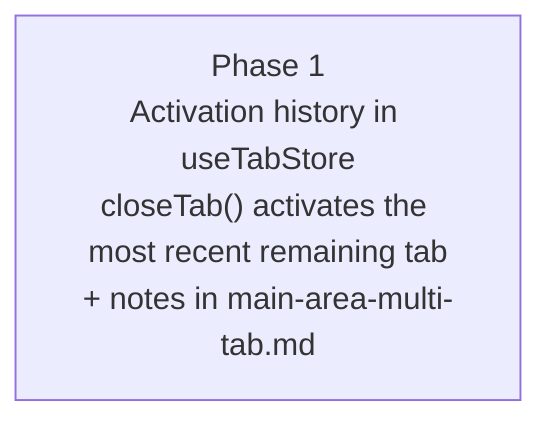

# Restore the Previously Active Tab When the Active Tab Is Closed — Implementation Plan

> Design document: [doc/design/completed/restore-previous-tab-on-close.md](../completed/restore-previous-tab-on-close.md)
> Issue: #92
> Created 2026-11-27. The design document is final. This plan does not revisit its decisions.
> "Design: <section>" below points to a section of the design document's Design Considerations.

## Scope

All Functional Requirements (FR1 to FR6) and the resolved Design Considerations of the design document:

- A plain (non-reactive), unexposed array of tab ids inside the `useTabStore` setup closure, most recently activated first (FR1, Design: "How much history to remember", "How and where the history is stored").
- `setActiveTab()` moves the given id to the front of the history and skips `null` (FR1).
- `closeTab()` removes the closed id from the history in its synchronous part, together with `tabs.value.splice()` (FR4, Design: "How and where the history is stored").
- `closeTab()` picks the next active tab in its synchronous part after the awaits, only if the closed tab is still active then: the first id in the history that still exists in `tabs`; if none, `tabs[0]`; if no tab remains, `null` (FR2, FR3, Design: "When the next active tab is decided inside `closeTab()`", "Safety-net fallback…").
- No special handling in `openRecipeInNewTab()`; the Load-failure behavior follows from the new `closeTab()` rule (FR5).
- Short notes in `doc/design/completed/main-area-multi-tab.md` pointing to the new design document, landed together with the implementation (Design: "Updating the completed design document").
- Unit tests listed in the design document's Acceptance Criteria.

FR6 (memory only) needs no code beyond keeping the history in a closure variable.

## Out of scope

Taken from the design document's "Out of Scope". This plan does not implement:

- Persisting the history across restarts.
- New navigation features based on the history (e.g. Ctrl+Tab "most recently used" switching, "reopen closed tab").
- Changes to the tab bar UI (`MainArea.vue`) or to tab ordering.
- New e2e tests.

Also not done (rejected options in the design document): exposing the history as a `ref` (Design: "How and where the history is stored", option B), an `activatedAt` field on tab objects (option C), a right/left-neighbor fallback (Design: "Safety-net fallback…", options B and C), deciding the next tab before the awaits (Design: "When the next active tab is decided…", option B), and leaving the completed document untouched (Design: "Updating the completed design document", option A).

## Current code check

The design document's Background matches the current code. Additional facts that affect the plan:

- `client/stores/useTabStore.js`:
  - `nextTabIdNumber` is already a plain `let` in the setup closure; the history goes next to it.
  - `setActiveTab(tabId)` returns early when `activeTabId.value === tabId`, otherwise writes `activeTabId.value` and calls `resetState()`. It is the only writer of `activeTabId` in `client/` (checked by grep; `MainArea.vue` and `MenuArea.vue` only read it).
  - `createTab()` pushes the tab and then calls `setActiveTab(tab.id)`, so the new id always reaches the history.
  - `closeTab()` re-finds the index after the two awaits (`if (index === -1) return`), then calls `entryManager.removeEntry()`, `executionLogService.removeLogs()`, `tabs.value.splice(index, 1)` and, if `activeTabId.value === tabId`, `setActiveTab(tabs.value[0]?.id ?? null)`. There is no `await` in this part.
  - `openRecipeInNewTab()` calls `await closeTab(tab.id)` in its `catch` and rethrows.
- `client/stores/__tests__/useTabStore.test.js` provides `entryPersistanceService` as `{}` and states that `openRecipeInNewTab()` is tested in `useTabStore.recipe.test.js`.
- `client/stores/__tests__/useTabStore.recipe.test.js` `describe('useTabStore.openRecipeInNewTab')` test "closes the created tab and rethrows when restoring fails" already asserts `store.activeTabId === existing.id`, but `existing` is the only other tab and therefore also `tabs[0]`, so it passes under both the old and the new rule.
- Other tests that call `closeTab()` (`MainArea.test.js`, `ExecutionLogView.test.js`, `RecipeItem.test.js`, `MenuArea.test.js`) only close the last tab(s) or a tab whose successor is the same under both rules; none of them asserts the `tabs[0]` rule. They need no change.
- `doc/design/completed/main-area-multi-tab.md` (Japanese) states the `tabs[0]` rule in: section 2 (the `closeTab()` comment in the store code sketch and the `closeTab(tabId)` bullet of the action list), section 6 "タブ削除後のアクティブタブ" and its "テスト" bullet, and section 6 "失敗時のアクティブタブ".

## Phase overview

The feature is small and touches one store function pair, so there is a single implementation phase. No behavior-preserving refactor is needed first: the history is new private state and the only replaced line is the `tabs[0]` choice in `closeTab()`. The completed-document notes are in the same phase because the design document requires them to land together with the implementation.

---

## [Resolved] Phase 1: Activate the previously active tab on close

**Goal:** Closing the active tab activates the most recently activated remaining tab, for user closes and for the automatic close in `openRecipeInNewTab()`.

**Files to change:**

- `client/stores/useTabStore.js`
  - Add `const activationHistory = []` (name is an implementation choice) next to `nextTabIdNumber`, with a comment: tab ids, most recently activated first, each id at most once, in memory only, not exposed (FR1, FR6).
  - `setActiveTab(tabId)`: after the existing early return, when `tabId !== null`, remove `tabId` from `activationHistory` if present and insert it at the front. Keep the existing `activeTabId` write and `resetState()` call unchanged. Update the JSDoc to mention the history.
  - `closeTab(tabId)`: in the synchronous part after the awaits, next to `tabs.value.splice(index, 1)`, remove `tabId` from `activationHistory`. Replace `setActiveTab(tabs.value[0]?.id ?? null)` with `setActiveTab(<next>)`, where `<next>` is the first id in `activationHistory` for which a tab exists in `tabs.value`, otherwise `tabs.value[0]?.id ?? null` (safety net). Keep the guard `if (activeTabId.value === tabId)` and keep the part free of `await`. A small private helper (e.g. `findNextActiveTabId()`) inside the closure is acceptable; it is not returned from the store.
  - Update the `closeTab()` JSDoc to describe the new rule and the safety net.
  - `openRecipeInNewTab()`: no code change. Update its JSDoc to say that on failure the tab active before the Load becomes active again (FR5).
- `doc/design/completed/main-area-multi-tab.md`
  - Add a one-line note at each place listed in "Current code check" saying that the `tabs[0]` rule (and the Load-failure exception) was superseded by `doc/design/completed/restore-previous-tab-on-close.md`. Do not rewrite the original text (Design: "Updating the completed design document", option B). See Notes for reviewer N3.

**Behavior that must not change:**

- Closing an inactive tab does not change `activeTabId` and does not call `resetState()` (FR4).
- Closing the last tab leaves `tabs` empty, `activeTabId === null`, `activeTab === null`, `visibleTabs` empty (FR3).
- `setActiveTab()` with the already active id does nothing (no `resetState()`); with a different id or `null` it calls `resetState()` exactly as today.
- `closeTab()` call order `deleteComm` → `shutdownRunner` → `removeEntry` → `removeLogs`, tolerance of host-side failures, no confirmation, no-op for unknown ids, and tab limit handling.
- The store's returned API (`tabs`, `activeTabId`, `nextTabNumber`, getters, actions) and the shape of tab objects (`{ id, label, rootEntryId, commStatus, scrollTop }`).
- `openRecipeInNewTab()` still closes the created tab and rethrows on restore failure.
- Tab order in `tabs` and the tab bar UI.

**Tests to add / update:**

- `client/stores/__tests__/useTabStore.test.js`, `describe('useTabStore.closeTab')`:
  - Replace `it.each([0, 1, 2])('activates tabs[0] when the active tab at index %i is closed')` with tests for:
    - AC1: create A, B, C (C active), `setActiveTab(A)`, close A → `activeTabId === C.id` (not `tabs[0]` = B).
    - AC3: the same "close the active tab → the previously active tab becomes active" check with the closed tab at index 0, 1 and 2 (e.g. `it.each`), each time with a previous tab that is not `tabs[0]` after the close where possible, so that the test fails under the old rule.
    - AC2: create A, B, C; `setActiveTab` A, then B, then C; close B (inactive) → C stays active; close C → `activeTabId === A.id`.
  - Keep unchanged: "keeps the active tab when an inactive tab is closed" (AC4) and "leaves no tabs and no active tab after closing the last tab" (AC5).
  - Optional (not required by the design document): a test that the next tab is decided after the awaits, i.e. if the user activates another tab while `deleteComm()` is pending, closing the (no longer active) tab keeps that tab active. This pins Design: "When the next active tab is decided…"; see Notes for reviewer N4.
- `client/stores/__tests__/useTabStore.recipe.test.js`, `describe('useTabStore.openRecipeInNewTab')`:
  - AC6: add a test (or extend "closes the created tab and rethrows when restoring fails") where the tab active before the Load is **not** `tabs[0]` (e.g. create X, then A so A is active), the restore fails, the error is rethrown, the created tab is removed, and `activeTabId === A.id`. See Notes for reviewer N2 for the file choice.

**Completion criteria:**

- `npm test` passes (AC7).
- `npm run lint` passes (AC7).
- Manual check with `npm run electron:start`:
  - Open three tabs, click the first, close it with its x button → the third tab (previously active) becomes active, not the second.
  - Open tabs A, B, C, click A, B, C in order, close B, then close C → A becomes active.
  - Close an inactive tab → the active tab does not change.
  - Close the last tab → the empty state appears.
  - With a non-leftmost tab active, Load a broken recipe file → an error is shown, no new tab remains, and the tab that was active before the Load is active again.

---

## Acceptance Criteria

| # | Criterion (from the design document) | FR | Phase | Covered by |
|---|---|---|---|---|
| AC1 | Create A, B, C (C active), activate A, close A → C becomes active (not `tabs[0]` = B). | FR1, FR2 | 1 | `useTabStore.test.js` `useTabStore.closeTab` (replacement test) |
| AC2 | Create A, B, C; activate A, B, C; close B (inactive), then close C (active) → A becomes active. | FR1, FR2, FR4 | 1 | `useTabStore.test.js` `useTabStore.closeTab` |
| AC3 | The AC1 result does not depend on the position (first/middle/last) of the closed tab. | FR2 | 1 | `useTabStore.test.js` `useTabStore.closeTab` (`it.each` over index) |
| AC4 | Closing an inactive tab keeps the active tab. | FR4 | 1 | `useTabStore.test.js` `useTabStore.closeTab` "keeps the active tab when an inactive tab is closed" (unchanged) |
| AC5 | Closing the last tab leaves `tabs` empty, `activeTabId === null`, `visibleTabs` empty. | FR3 | 1 | `useTabStore.test.js` `useTabStore.closeTab` "leaves no tabs and no active tab after closing the last tab" (unchanged) |
| AC6 | With A active, a failing `openRecipeInNewTab()` closes the new tab, rethrows, and A is active again. | FR5 | 1 | `useTabStore.recipe.test.js` `useTabStore.openRecipeInNewTab` (see N2) |
| AC7 | All other existing `useTabStore` tests pass unchanged; `npm test` and `npm run lint` pass. | all | 1 | Completion criteria of Phase 1 |
| — | History is memory only. | FR6 | 1 | No test (per the design document); holds because the history is a closure variable that is never written to storage. |

## Notes for reviewer

- **N1: `setActiveTab()` with an id that is not in `tabs`.** The design document says the history skips only `null`. `setActiveTab()` does not validate the id today, so an unknown id would enter the history (and become `activeTabId`). It is harmless for `closeTab()` because the next tab is chosen only among ids that still exist in `tabs`, but the history could hold stale ids. The plan follows the design document literally (skip only `null`) and does not add validation. Please confirm.
- **N2: Where the AC6 test lives.** The design document says the acceptance criteria are verified in `client/stores/__tests__/useTabStore.test.js`. That file provides `entryPersistanceService` as `{}` and explicitly delegates `openRecipeInNewTab()` to `useTabStore.recipe.test.js`, which has the real `EntryPersistanceService` and a failing-restore test already. The plan puts the AC6 test in `useTabStore.recipe.test.js`. If the reviewer prefers `useTabStore.test.js`, it would need a stubbed `entryPersistanceService` with `pickRecipe` / `restoreRecipe` for that test.
- **N3: The notes in `main-area-multi-tab.md`.** The design document lists "section 2 `closeTab()` description". Section 2 has two such places (the comment in the store code sketch and the `closeTab(tabId)` bullet); the plan adds the note at the bullet and leaves the code-sketch comment alone unless the reviewer wants a note there too. The language of the notes is not specified; the plan writes them in Japanese to match the completed document.
- **N4: No test for the safety net and the "after the awaits" decision.** The `tabs[0]` safety net cannot be reached through the public API (every tab is in the history from `createTab()`), so the plan does not test it. The "decide after the awaits" behavior is testable with a pending `deleteComm()` mock but is not an acceptance criterion; the plan lists it as optional. Please say if either should be required.
- **N5: Phase 1 — `main-area-multi-tab.md` notes not added.** The implementation run was instructed not to modify design documents under `doc/design/`, so the superseded-rule notes in `doc/design/completed/main-area-multi-tab.md` (listed under Phase 1 "Files to change") were not added. All code and test changes of Phase 1 are done, and `npm test` and `npm run lint` pass. The notes still need to be added in a separate change that is allowed to edit design documents. The manual `npm run electron:start` checks were not run.
- **N6: Phase 1 — optional test added.** The optional N4 test ("decides the next active tab after the host-side cleanup") was added to `useTabStore.test.js` `useTabStore.closeTab`, using a pending `deleteComm()` mock.
